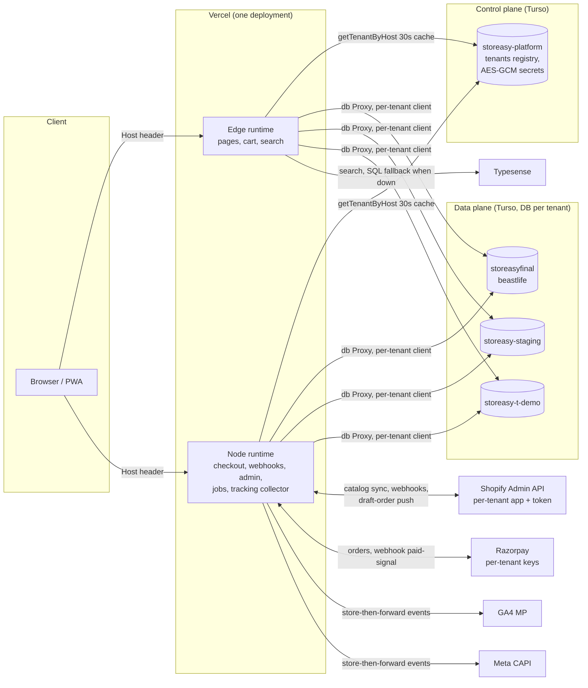
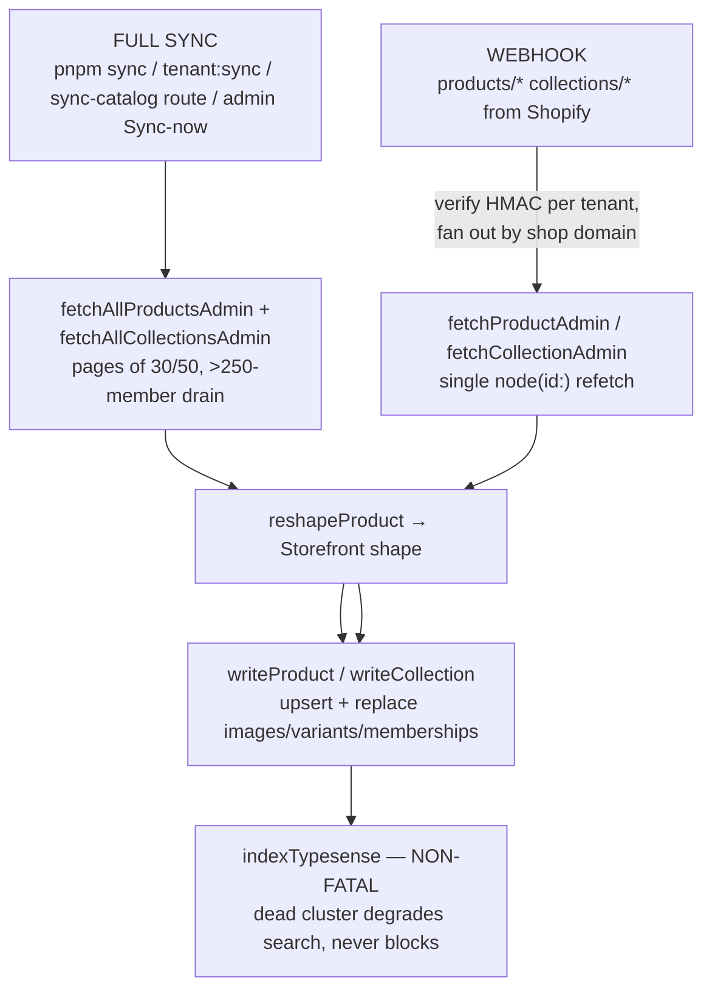
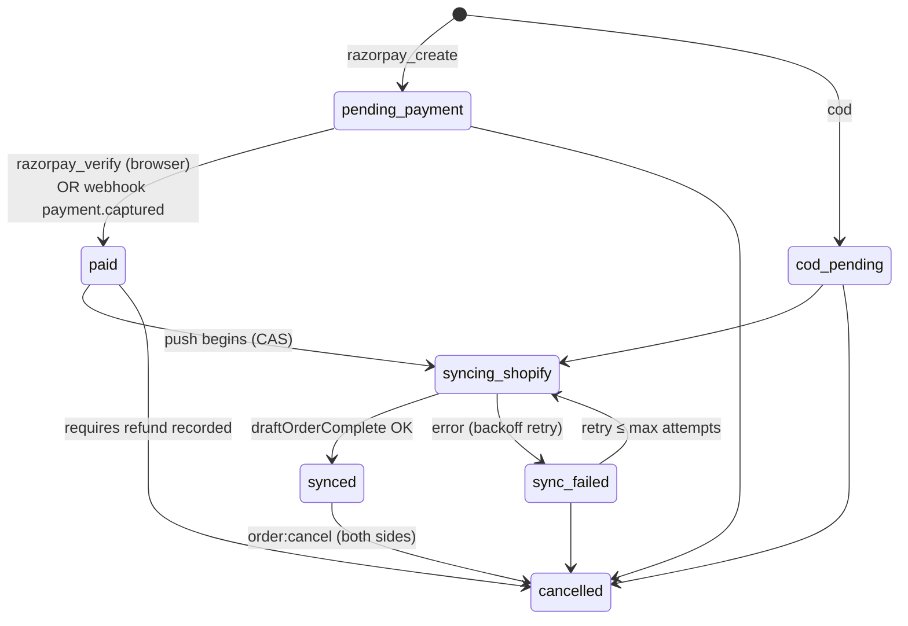

# Storeasy — Complete Feature & Architecture Guide

> The master reference for everything built in sessions S1–S24: every feature, how to
> use it, what it needs to work, and how the whole system fits together.
> Reader: the technical founder/operator. Last updated: 2026-10-27 (post-S24).
>
> Companion docs: [platform.md](./platform.md) (tenancy architecture notes per session),
> [onboarding.md](./onboarding.md) (partner runbook), [orders.md](./orders.md),
> [refunds.md](./refunds.md), [tracking.md](./tracking.md), [operations.md](./operations.md),
> [shopify-order-sync.md](./shopify-order-sync.md).

---

## Table of contents

1. [What Storeasy is](#1-what-storeasy-is)
2. [Feature catalog](#2-feature-catalog)
   - [A. Shopper storefront](#2a-shopper-storefront)
   - [B. Merchant console (/admin)](#2b-merchant-console-admin)
   - [C. Platform operator](#2c-platform-operator)
   - [D. Data & tracking](#2d-data--tracking)
   - [E. Operations](#2e-operations)
   - [F. Known quirks & follow-ups](#2f-known-quirks--follow-ups)
3. [Technical architecture](#3-technical-architecture)
4. [Reference](#4-reference)
5. [Runbooks & current state](#5-runbooks--current-state)
6. [Appendix: session history S1–S24](#6-appendix-session-history)

---

## 1. What Storeasy is

**Storeasy is a multi-tenant e-commerce storefront platform over Shopify.** A merchant
connects their Shopify store; Storeasy pulls the catalog into the tenant's own database
and serves a fast PWA storefront with its **own** cart, discount/offer engine, custom
checkout (COD + Razorpay — the India GoKwik/Shopflo category), shipping engine,
upsells/cross-sells, merchandising CMS, first-party GA4/Meta tracking, and a no-deploy
merchant console. One codebase, one deployment; each tenant gets its own database,
credentials, branding, content, and configuration.

It began as **storeasy26**, a single-store build for **BeastLife** (real catalog:
`beastlife-dev.myshopify.com`, ~319 products / ~281 collections), built in numbered
sessions S1–S19. On 2026-10-27 it pivoted into the platform: S20 added the tenancy
core, S21 onboarding + webhook sync, S22 the merchant/operator consoles, S23 the
merchandising CMS + upsells, S24 platform ops + the two-tenant dry run.

**Stack (locked):** Next.js 16 App Router (JavaScript, ESM) · Turso/libSQL + Kysely ·
Typesense search with SQL LIKE fallback · edge runtime for pages, Node runtime for
money/crypto routes · Vercel (Hobby) · pnpm.

**Deployment reality today:**

| Environment | URL | State |
|---|---|---|
| Production | storeasy26.vercel.app | **Pre-platform build (S20)** — serves BeastLife via the env-fallback tenant; S21–S24 are NOT deployed |
| Staging | storeasy26-staging.vercel.app | Same vintage (S20); own Turso DB + Typesense collection |
| Local dev | localhost:3007 | Full S24 platform; control plane live |

**Live tenants** (control plane `storeasy-platform` on Turso):

| Tenant | Hosts | Database | Notes |
|---|---|---|---|
| `beastlife` | storeasy26.vercel.app, localhost, localhost:3007/3008 | `storeasyfinal` | Tenant #1; config mirrors the original env |
| `beastlife-staging` | storeasy26-staging.vercel.app | `storeasy-staging` | Staging mirror; same dev store |
| `demo` | localhost:3009, 127.0.0.1:3007 | `storeasy-t-demo` | Provisioned from blank in S21; fully re-branded via console in S23 |

---

## 2. Feature catalog

Every feature below follows the same five-part shape: **What** it does · **Use** —
exact URLs/clicks/commands · **Setup** — what must exist for it to work · **Files** ·
**How** it's implemented.

### 2A. Shopper storefront

#### PWA shell
- **What**: installable app — manifest, service worker with offline fallback, icons;
  dark storefront chrome with sticky header.
- **Use**: visit the storefront → browser "Install app"/Add to Home Screen. Works per
  tenant domain.
- **Setup**: nothing beyond deployment; `manifest.webmanifest` + `/icons/*` ship with
  the app.
- **Files**: `public/manifest.webmanifest`, `public/sw.js`, `public/offline.html`,
  [components/ServiceWorkerRegister.js](../components/ServiceWorkerRegister.js),
  `app/icon.svg` (lime bolt on dark; served as `/icon.svg`).
- **How**: the layout mounts `ServiceWorkerRegister` (production only) which registers
  `sw.js` (v2, neutral `storeasy-*` cache names since S36): precaches `/offline` +
  `/manifest.webmanifest` + the 192px icon; navigations are network-first with the
  offline shell as fallback; `/_next/static/*`, `/icons/*` and `cdn.shopify.com` are
  stale-while-revalidate; APIs pass through uncached. **Manifest and offline page are
  DYNAMIC per-tenant routes since S36** (`app/manifest.webmanifest/route.js`,
  `app/offline/route.js`): name/colors come from the tenant's live release brand, so
  each origin's SW caches its own branding at install. Icons remain the shared
  platform set until the media pipeline (BE15, S38).

#### Home page (CMS-driven)
- **What**: hero (title with accent highlight, subtitle, badge, two CTAs) +
  orderable sections (collections grid, newest products) + optional announcement bar —
  all merchant-editable, per tenant, no deploy.
- **Use**: `/` on any tenant host. Edit in `/admin/storefront`.
- **Setup**: none — absent CMS rows render name-derived defaults; BeastLife's classic
  hero is seeded as real rows (`pnpm tenant:seed-cms`).
- **Files**: [app/page.js](../app/page.js), [lib/cms/store.js](../lib/cms/store.js),
  [lib/cms/defaults.js](../lib/cms/defaults.js).
- **How**: `getHero()`/`getHomeSections()` read `cms_blocks` with merge-over-default
  healing; the hero `highlight` substring is wrapped in the accent span at render;
  section data (`getFeaturedCollections`, `getNewestProducts`) is fetched only for
  enabled sections.

<!-- S39 (MC11): header nav supports ONE level of nesting — indent lines in
the console editor; items with children render as native <details> dropdowns
(keyboard/screen-reader friendly, zero client JS). The footer links only to
pages that actually exist on the store (the old hardcoded /policies/* list
404'd on tenants without those pages); release validation checks child links
too. -->
#### Header, footer, announcement bar
- **What**: brand wordmark (two-part accent split), search box, cart button,
  collection scroller or custom nav; footer with shop/company/support columns,
  tagline, legal line; optional lime announcement strip.
- **Use**: automatic on every page. Customize nav + announcement in
  `/admin/storefront`; identity strings in `/admin/settings`.
- **Setup**: `config.site` (name, logo {text1,text2}, footer_tagline, support
  email/phone, legal_name) — provision/settings fill it; nav defaults derive from the
  catalog (header: all collections; footer: top 5).
- **Files**: [components/Header.js](../components/Header.js),
  [components/Footer.js](../components/Footer.js), [app/layout.js](../app/layout.js)
  (`chromeData()`), [lib/site.js](../lib/site.js).
- **How**: the layout makes one tenant-scoped pass collecting brand + CMS chrome and
  passes plain props; `nav` null = catalog-derived (pre-CMS behavior), an array
  replaces it.

#### Collections & browsing
- **What**: all-collections index with **merchant curation** (S38 / SF02:
  featured-with-badge first, then an explicit order, hidden handles dropped;
  the home Collections row uses the featured list too); collection pages with
  **URL-backed sort + filters** (S38 / SF03: `?sort=featured|new|price-asc|
  price-desc`, `?type=<product_type>` chips with counts, `?instock=1`, all
  combinable with `?page=N` — back/forward/shared links restore the exact
  view; zero-results shows a Clear-all action); pagination (48/page, prev/next,
  per-page canonicals, out-of-range → 404).
- **Use**: `/collections`, `/collections/<handle>?sort=…&type=…&instock=1`.
  Curate in `/admin/storefront` → Collections index (release-governed like
  every block; publish validation blocks handles that aren't in the catalog).
- **Setup**: a synced catalog (full sync or webhooks).
- **Files**: `app/collections/*`, `components/CollectionControls.js`,
  [lib/repo.js](../lib/repo.js) (`getAllCollections`,
  `getCollectionsByHandles`, `getProductsInCollection` with
  sort/inStock/type, `getCollectionTypeFacets`).
- **How**: sub-millisecond SQLite reads from the tenant DB; membership rows
  (`collection_products`) carry Shopify's ordering as `position` (= the
  "featured" sort); filter chips are plain links so every state has a URL.

#### Product page (PDP)
- **What**: gallery with fade-in images, variant picker, price/compare-at with
  savings, availability, merchant HTML description, Product + BreadcrumbList JSON-LD,
  breadcrumbs, and the **"Pairs well with"** strip (S23). S38 (SF04):
  **merchant accordions** under the description (`pdp_extras` block —
  shipping/returns/lab-report panels, sanitized at save, release-governed),
  a **sticky mobile CTA** bar (appears when the add button scrolls away;
  title + price + add/view-cart), and **invalid-variant feedback** (values
  that don't exist with the current selection render struck-through with a
  "combination isn't available" notice; sold-out combinations are marked).
- **Use**: `/products/<handle>`. Configure a manual pairs strip in `/admin/upsells`;
  accordions in `/admin/storefront` → Product page extras;
  otherwise the strip auto-fills with same-collection products.
- **Setup**: synced catalog; nothing else.
- **Files**: `app/products/[handle]/page.js`,
  [components/ProductGallery.js](../components/ProductGallery.js),
  [components/ProductPurchase.js](../components/ProductPurchase.js),
  [lib/cms/placements.js](../lib/cms/placements.js) (`getPdpPairs`).
- **How**: `generateMetadata` throws `notFound()` pre-stream so missing handles return
  a real 404; pairs resolve manual placement first, else a shared-collection-count
  ranked query (deterministic: shared count, then title); JSON-LD brand falls back to
  the tenant's site name.

#### Search
- **What**: instant product search with images/prices. **BE05 decision (S38):
  SQL over the local catalog IS the supported engine** — upgraded to
  multi-term AND matching with deterministic ranking (in-stock first, then
  title-prefix, then title-substring, then the rest). Typesense remains an
  optional env-configured upgrade (reviving the lapsed cluster is paid and
  user-gated); when configured and reachable it serves, otherwise SQL does,
  transparently. S38 (SF05) search box: debounce + stale-response abort,
  **per-session recent searches** (sessionStorage, shown on focus, clearable)
  and **full keyboard navigation** (↑/↓/Enter/Escape).
- **Use**: the header search box on every page; `/search?q=…` for the full page.
  `/api/health` names the live engine (`search.engine`); a dead optional
  Typesense no longer degrades health.
- **Setup**: nothing — SQL works out of the box. For Typesense: set
  `TYPESENSE_HOST/PORT/PROTOCOL/API keys` + per-tenant `typesense_collection`,
  then `pnpm sync:search` to index. Index-rebuild-and-swap + synonyms are
  Typesense-side features and land with a revival, if ever.
- **Files**: `app/api/search/route.js` (edge),
  [components/SearchBox.js](../components/SearchBox.js),
  [lib/typesense-search.js](../lib/typesense-search.js) (edge-safe fetch),
  [lib/typesense.js](../lib/typesense.js) (admin client + schema, Node sync only),
  `searchProductsInDb` in [lib/repo.js](../lib/repo.js).
- **How**: the route tries Typesense and falls back on error/not-configured; responses
  are tagged `source: "typesense" | "database"`. Indexing is NON-FATAL inside syncs
  (a dead cluster can't block catalog freshness).

#### Cart drawer
- **What**: slide-over cart — line items with qty steppers, derived free-gift lines,
  coupon box with validation reasons, applied-offer rows with amounts, shipping
  estimate + "Add ₹X more for free shipping" nudge, grand total, "You save" pop,
  the merchant-configured **upsell slot** (one-tap add), checkout CTA. Survives
  reload; count correct on first paint.
- **Use**: cart icon anywhere; adding to cart opens it.
- **Setup**: none; the upsell slot appears only when a `cart_upsell` placement exists.
- **Files**: [components/cart/CartDrawer.js](../components/cart/CartDrawer.js),
  [components/cart/CartContext.js](../components/cart/CartContext.js),
  [lib/cart.js](../lib/cart.js), `app/api/cart/route.js` (edge),
  `app/api/upsell/route.js`.
- **How**: the cart is SERVER state — httpOnly `cart_session` cookie → `carts` +
  `cart_items` rows in the tenant DB storing full GIDs; every mutation re-joins items
  to the live catalog and re-runs the offer engine, so prices/offers are always
  current. Actions on `/api/cart`: `add`, `setQty`, `remove`, `setCoupon`, `clear`.
  The upsell slot lazy-fetches `/api/upsell?exclude=<ids>` when the drawer opens and
  hides products already in the cart.

#### Offers & coupons (shopper view)
- **What**: four live offer types — Buy-X-Get-Y free, quantity-tiered % discounts,
  threshold free gift, coupon codes (percent/flat, min-subtotal, exclusive) — stacking
  deterministically, applied in the drawer and honored through checkout and the
  Shopify push.
- **Use**: automatic; coupons typed in the drawer. Six offers seed every tenant:
  `bxgy-bcaa-mango` (buy 2 get 1), `tiered-whey` (2→5% / 3→10% on tag Whey),
  `free-gift-shaker` (shaker over ₹1,499), `coupon-beast10` (10%), `coupon-flat200`
  (₹200 min ₹999), `coupon-solo25` (25% min ₹1,499, exclusive) — BeastLife-targeted
  seeds a new merchant edits during onboarding (quirk #14).
- **Setup**: offers exist per tenant (seeded defaults; edited in `/admin/offers`).
- **Files**: [lib/offers/engine.js](../lib/offers/engine.js),
  [lib/offers/store.js](../lib/offers/store.js), [lib/offers/config.js](../lib/offers/config.js).
- **How**: see §3.6 — evaluated inside every `getCart`, discounts land as one
  FIXED_AMOUNT order discount on the Shopify side.

#### Checkout (COD + Razorpay)
- **What**: custom multi-step guest checkout (Address → Review → Payment) with live
  per-method shipping recompute, COD fee display, Razorpay modal in the tenant's
  name, idempotent order creation, and a confirmation page with the order-status link.
- **Use**: drawer → Checkout → `/checkout`.
- **Setup**: COD works with zero config. Razorpay appears only when the TENANT has
  `razorpay_key_id` (+ key secret for verification, + webhook secret for the
  paid-signal backstop) — set in `/admin/settings`. The Razorpay webhook must point
  at `<prod>/api/razorpay/webhook`.
- **Files**: `app/checkout/page.js`,
  [components/checkout/CheckoutFlow.js](../components/checkout/CheckoutFlow.js),
  `app/api/checkout/route.js` (Node), [lib/razorpay.js](../lib/razorpay.js).
- **How**: API actions `cod`, `razorpay_create`, `razorpay_verify` — each requires an
  `idempotencyKey` (one per payment attempt, rotated once on 409). The server
  recomputes totals (goods + engine discounts + shipping) — the client never prices
  anything. See §3.5 for the paid-signal and push pipeline.

#### Shipping (shopper view)
- **What**: free-shipping threshold, flat rate, COD fee (+ optional waiver), pincode
  zones — identical numbers in the drawer estimate, checkout, charge, and the Shopify
  order line.
- **Use**: automatic; the checkout pincode field activates zone pricing.
- **Setup**: merchant edits rules in `/admin/settings` → Shipping; code defaults
  apply until then.
- **Files**: [lib/shipping.js](../lib/shipping.js) (§3.8).

#### Order status page (guest)
- **What**: tokenized, no-login order tracking — Placed → Confirmed → Being prepared →
  Shipped steps from our state machine MERGED with live Shopify fulfillment +
  tracking links; cancelled state with refund guidance; COD "due on delivery".
- **Use**: the confirmation page links it; shape `/orders/<id>?t=<token>`. Links are
  also what you'd put in comms.
- **Setup**: `ORDER_LINK_SECRET` (or the razorpay-secret fallback chain) for token
  signing; Shopify fulfillment display needs the synced order.
- **Files**: `app/orders/[orderId]/page.js` (Node),
  [lib/shopify-order-status.js](../lib/shopify-order-status.js),
  `orderStatusToken/verifyOrderStatusToken` in [lib/orders.js](../lib/orders.js).
- **How**: token = first 20 hex of `sha256(id|secret)`; bad token → 404; noindex.
  Shopify fulfillment reads degrade to null gracefully (page still renders our
  states). Native Shopify emails cover confirmation + shipping notifications (S18
  finding — no custom email infra).

#### Content pages
- **What**: About, Contact, and policy pages (shipping/returns/terms/privacy) +
  merchant-added pages — per tenant, CMS-overridable, with a shared renderer.
  S38 (SF13): sections are **typed** — text (heading + paragraphs), **rich
  HTML** (allowlist-sanitized at save) and **image** (library `/api/media/…`
  or https, alt required, optional caption); v1 rows normalize lazily (page
  schema v2). S38 (SF14): optional **effective date** rendered under the
  title; checkout links the store's own privacy/terms/refund/shipping pages
  next to the pay button (enabled pages only); publish validation **warns**
  when a non-BeastLife store has no privacy or terms/refund page.
- **Use**: `/about`, `/contact`, `/policies/<slug>` (custom pages serve there too).
  Edit in `/admin/storefront` → Content pages ("Privacy policy" and
  "Terms & refund" templates scaffold the legal pages).
- **Setup / cross-tenant containment (S38)**: the default templates carry
  **BeastLife's real copy** and serve ONLY the beastlife tenants + legacy env
  mode (`brandDefaultsApply()`); every other tenant starts page-less and
  creates its own (no cross-tenant legal text, ever). BeastLife's default
  contact page still auto-injects the tenant's support email/phone.
- **S39 additions**: **faq** section kind (SF16 — native `<details>` keyboard
  accordions, stable `#q-…` deep-link anchors that auto-open + scroll, ¶
  copy-link buttons); **campaign pages** (SF17 — `family='campaign'` rows
  served at `/campaigns/<slug>` ONLY inside their UTC visibility window
  (edited in merchant-local time, stored as instants), noindex, excluded from
  the sitemap, and internal links keep the visitor's `utm_*` params); the
  **contact page always works** (SF15 — accessible form with server
  validation, honeypot, 5/hour rate limit; renders with or without a content
  page) and messages flow through the notification service into the console
  inbox.
- **Files**: `app/about|contact|policies|campaigns/[slug]/page.js`,
  [components/ContentPage.js](../components/ContentPage.js),
  [components/FaqSection.js](../components/FaqSection.js),
  [components/ContactForm.js](../components/ContactForm.js),
  [lib/content/utm.js](../lib/content/utm.js),
  [lib/cms/store.js](../lib/cms/store.js) (`getContentPage`,
  `validatePageSections`, `campaignVisible`, `brandDefaultsApply`),
  [lib/content/pages.js](../lib/content/pages.js) (default templates).

#### Consent banner & pixels
- **What** (S33 / SF24): DPDP consent with PURPOSES — Analytics (GA4) and
  Marketing (Meta) are separate choices; Allow all / No thanks / Settings with
  per-purpose toggles, plus a persistent "Privacy" chip that reopens the panel
  anytime. Essential processing (orders, cart) is labeled always-on.
- **Use**: automatic on first visit per tenant origin; change anytime via the
  Privacy chip — saving a change reloads so every tag re-evaluates (withdrawal
  stops client tags immediately; server forwarding gates per purpose on the
  consent stored WITH each event).
- **Setup**: pixels need tenant GA4/Meta ids (Settings); the banner works regardless.
- **Files**: [components/analytics/ConsentBanner.js](../components/analytics/ConsentBanner.js),
  [components/analytics/Pixels.js](../components/analytics/Pixels.js),
  [lib/track/names.js](../lib/track/names.js) (consent helpers, shared vocab).
- **How**: `_consent` cookie, versioned JSON `{"v":2,"a":0|1,"m":0|1,"at":…}`
  (legacy "granted"/"denied" still parse); gtag loads only with analytics, fbq
  only with marketing; granting fires `consent-granted` so tags light up
  without a reload.

#### SEO surface
- **What**: per-tenant metadata (title template, description), canonicals everywhere,
  PDP Product/AggregateOffer + BreadcrumbList JSON-LD, per-tenant sitemap (products +
  collections + content pages), robots.txt blocking /api + /checkout + /admin,
  branded 404/error pages (crawler-safe noindex on streamed 404s).
- **Files**: [app/layout.js](../app/layout.js) `generateMetadata`,
  [app/sitemap.js](../app/sitemap.js), `app/robots.js`, `app/not-found.js`,
  [lib/site.js](../lib/site.js).

### 2B. Merchant console (`/admin`)

One console per tenant, served on that tenant's own host. **Auth**: password login →
tenant-bound session cookie (§3.9); rotating the password revokes all sessions.
Navigation: **Offers · Orders · Storefront · Catalog · Media · Theme · Brand · Releases · Upsells · Integrations · Settings**.

#### Login
- **Use** (S26): `<tenant-host>/admin` → `/admin/login`; sign in with your EMAIL +
  password (individual account). "Forgot password?" emails a 1-hour reset link;
  teammates join via `pnpm invite:create` acceptance links. Until a tenant has its
  first user, the email field can stay empty and the tenant's bootstrap console
  password (secret `admin_password`) still works. Local hosts table in §5.1.
- **Setup**: create the first user with
  `USER_PASSWORD=… pnpm user:create -- --tenant <slug> --email you@… --role owner`
  (this disables the bootstrap password for that store). Env `ADMIN_PASSWORD`
  serves the default/env tenant in legacy mode only.
- **Files**: `app/admin/login/page.js`, `app/admin/accept-invite|reset/page.js`,
  `app/api/admin/login|logout|accept-invite|recover|reset/route.js`,
  [lib/admin-auth.js](../lib/admin-auth.js),
  [lib/platform/sessions.js](../lib/platform/sessions.js),
  [lib/platform/identity.js](../lib/platform/identity.js).

#### Offers tab
- **What**: list/toggle/edit/create/delete the four offer types; schedule windows
  (starts/ends); every save live on the next cart read.
- **Use**: `/admin/offers` → toggle switches, Edit, "+ New offer" (one form, four
  types, tier editor, datetime-local schedule).
- **How**: per-type validation server-side (422 OFFER_INVALID on bad configs —
  percent ≤ 90, tier bounds, coupon code regex); rows stored engine-shaped so the
  engine consumes them directly.
- **Files**: `app/admin/offers/page.js`, `components/admin/OffersAdmin.js` +
  `OfferForm.js`, `app/api/admin/offers*/route.js`,
  [lib/offers/validate.js](../lib/offers/validate.js).

#### Orders tab
- **What**: status-tab list with counts (all/paid/synced/sync failed/COD pending/
  pending payment/cancelled), search by id/email/phone, keyset "Load more"; detail
  view with customer, payment/sync state + errors, items (gift-flagged), totals, the
  full state-machine timeline, and a **Retry Shopify push** button that appears only
  on `sync_failed`.
- **Use**: `/admin/orders`, click through to `/admin/orders/<id>`.
- **How**: reads via [lib/admin/orders.js](../lib/admin/orders.js) (whitelisted
  status filter, LIKE search, `created_at` keyset cursor); retry goes through the
  same state-machine-guarded `pushOrderToShopify` as the crons — invalid states are
  refused, never forced.
- **Files**: `app/admin/orders/*`, `components/admin/OrdersAdmin.js` +
  `RetryPushButton.js`, `app/api/admin/orders*/route.js`.

#### Storefront tab (merchandising CMS)
- **What**: edit the announcement bar, hero, home-section order/titles/sizes, header
  nav, footer shop links, and content pages — each block shows a CUSTOMIZED badge and
  a per-block **Reset to default**; structured page editor (sections = heading +
  paragraphs, blank-line separated), new pages served at `/policies/<slug>`.
- **Use**: `/admin/storefront`. Nav items are typed one per line as `Label | /path`;
  an empty nav returns to the automatic catalog-derived list.
- **How**: blocks validate server-side ([lib/cms/validate.js](../lib/cms/validate.js) —
  href scheme checks, length caps, section-kind whitelist) and store as JSON rows;
  reads merge stored-over-default so partial configs heal.
- **Files**: `app/admin/storefront/page.js`,
  `components/admin/StorefrontAdmin.js`, `app/api/admin/storefront/route.js`.

#### Upsells tab
- **What**: manage `pdp_pairs` (per-product "Pairs well with", manual targets in
  display order) and `cart_upsell` (the drawer slot) placements; enable/disable,
  custom titles, positions. Products referenced by HANDLE.
- **Use**: `/admin/upsells` → "+ New placement".
- **How**: handles resolve to gids server-side (unknown handles 422 with names);
  unavailable targets are filtered at render; PDPs without a manual placement fall
  back to the automatic same-collection strip; the cart slot exists only when
  configured.
- **Files**: `app/admin/upsells/page.js`, `components/admin/UpsellsAdmin.js`,
  `app/api/admin/upsells*/route.js`, [lib/cms/placements.js](../lib/cms/placements.js).

#### Settings tab
- **What**: store identity (name, site URL, support contacts; domains read-only),
  Shopify connection status, Razorpay keys, GA4/Meta credentials, the **shipping
  rules editor** (flat rate, thresholds, COD fee/waiver, basis, pincode zones),
  catalog sync status + **Sync now**, and console-password rotation.
- **Use**: `/admin/settings` → edit → Save settings. Secret fields are write-only:
  a "Set ✓" hint shows presence, blank keeps the current value. Password rotation
  signs out every other session (your browser gets a fresh cookie).
- **Setup**: none — this IS the setup surface for payments/tracking/shipping.
- **How**: `PUT /api/admin/settings` validates
  ([lib/admin/settings.js](../lib/admin/settings.js): email/url/key-format checks,
  shipping config coercion + engine smoke-test) and merge-patches the CONTROL PLANE
  for the Host-resolved tenant only (the tenant id is never taken from the request
  body). Secret values never serialize back to the client. The env-fallback default
  tenant is read-only here (no control-plane row to patch). Changes go live within
  the 30s control-plane cache TTL. "Sync now" runs a full catalog sync inline
  (rate-limited 2/min; big catalogs → `pnpm tenant:sync`).
- **Files**: `app/admin/settings/page.js`, `components/admin/SettingsAdmin.js`,
  `app/api/admin/settings|sync/route.js`.

#### Brand tab
- **What** (S35 / MC10): design tokens for the storefront — ONE accent color
  drives a derived 50–900 ladder (lightness interpolation anchored at the
  picked color, hue/saturation kept — stays monotonic for extreme picks),
  plus background/text colors, corner radius (sm–xl) and type scale
  (compact/regular/large). Text contrast is WCAG-AA-gated: body text under
  4.5:1 BLOCKS the save; low-contrast accents warn. Button labels use the
  computed `accent-label` (black or white, whichever reads better on the
  actual button surface). Reset-to-theme returns the platform default (the
  original lime look).
- **How**: tokens live in `config.brand`; the root layout emits ONE
  `<style id="brand-vars">` block of CSS variables
  ([lib/brand.js](../lib/brand.js) — validated hex/enum values only), and every
  storefront component consumes `accent-*` Tailwind utilities mapped to those
  variables (S35 swept all hardcoded lime classes). No tenant row → zero
  override emitted, the defaults in globals.css apply. The ADMIN console keeps
  platform styling (deliberately not re-skinned by tenant brand). Changes go
  live within the 30s control-plane cache.
- **Files**: [lib/brand.js](../lib/brand.js), `app/admin/brand/page.js`,
  `components/admin/BrandAdmin.js`, `app/api/admin/brand/route.js`,
  `app/globals.css` (token defaults + @theme mapping), `app/layout.js`.

#### Theme tab
- **What** (S37 / MC07): kit library. A kit is a complete, versioned look for
  a vertical — surface colors (header/hero via `[data-kit="<id>-<version>"]`
  CSS blocks), display font, brand-token defaults, starter hero copy. Two
  kits ship: **Pulse** (nutrition/performance — the original dark+lime look,
  also the implicit default) and **Glow** (beauty/self-care — airy light
  surfaces, Fraunces serif display, rose accent, xl corners). Applying pins
  `config.theme = {kit, version}` and seeds brand + hero presets as DRAFTS —
  live changes only at the next publish, rollback always works.
- **Pinning** (OP07): version-keyed CSS selectors mean a future kit version
  ships as a NEW block; pinned tenants keep rendering theirs until they
  explicitly apply the upgrade. Within one version, CSS bugfixes apply (it's
  code). The kit pin rides the release snapshot like brand does.
- **Files**: [lib/themes/kits.js](../lib/themes/kits.js) (registry + applyKit),
  `app/admin/theme/page.js`, `components/admin/ThemeAdmin.js`,
  `app/api/admin/theme/route.js`, kit CSS in `app/globals.css`, surface
  tokens consumed by Header + the home hero, `/api/platform/themes` +
  `components/platform/ThemesPanel.js` (operator registry, read-only).

#### Storefront tab — section editor & draft preview (S37 / MC08)
- **What**: the home page is a composable section tree — Collections grid,
  Newest products, **Banner/CTA** (accent panel) and **Rich text**
  (allowlist-sanitized HTML, same sanitizer as PDP descriptions). Reorder
  (keyboard-reachable ↑/↓), hide, duplicate, remove, add; undo/redo;
  **autosave** (1.2s debounce) with an honest indicator (Unsaved → Saving →
  Saved-as-draft); the S35 conflict surface offers reload-or-overwrite.
  The **Draft preview pane** mints an S36 preview token and iframes the real
  storefront with real bindings at mobile/tablet/desktop widths.
- **Templates** (MC09): "New page from template" (FAQ, brand story,
  how-to-use, blank — [lib/content/templates.js](../lib/content/templates.js))
  prefills the page editor; Clone copies any existing page to a new slug.
  Collection/PDP template families arrive with their own variant systems (W4+).
- **Files**: `components/admin/SectionsEditor.js`,
  `components/admin/PreviewPane.js`, banner/rich_text validation in
  [lib/cms/validate.js](../lib/cms/validate.js), renderers in `app/page.js`.

#### Catalog tab (S39 / MC05 + MC06)
- **What**: the catalog browser. Shopify-owned VALUES (title, type, price,
  stock) are read-only, labeled, and deep-linked to Shopify admin; the
  console edits per-tenant PRESENTATION only: per-product **PDP modules**
  (ingredients / usage / specs accordions — the per-product half SF04
  deferred here; sanitized at save) and a short **badge**, plus
  **collection merchandising** — pinned products lead a collection's
  "Featured" order (ownership-validated: a pin must belong to the
  collection), everything else keeps Shopify's order. Overrides whose
  product was deleted from the catalog are flagged **ORPHANED**, never
  silently rendered or dropped. Live-on-save (catalog-adjacent, like
  placements — not release content; recorded in MC05).
- **Files**: [lib/catalog-overrides.js](../lib/catalog-overrides.js),
  `app/admin/catalog/page.js`, `app/api/admin/catalog/route.js`,
  `components/admin/CatalogAdmin.js`; pinned ordering in
  `getProductsInCollection` ([lib/repo.js](../lib/repo.js)).

#### Notifications & contact inbox (S39 / BE23 + SF15)
- **What**: THE send path for tenant-scoped messages
  ([lib/notifications.js](../lib/notifications.js)): every message is a
  durable intent row first (`queued`), delivered by the jobs queue
  (`send_notification`, with `after()` fast path), retried with backoff, and
  always honest — `queued | sent | failed`, provider errors recorded, the
  dev mock explicitly labeled **DEV MOCK** (nothing actually sends until
  `RESEND_API_KEY` is set). Idempotency keys dedupe replayed triggers; a
  missing recipient records a FAILED intent with the fix in the error text.
  **Consent separation**: `consent_class='marketing'` is schema-level and
  REFUSED without a consent reference — transactional mail never mixes with
  it. Control-plane identity mail (invites/resets) stays on lib/mail.js
  directly (platform-scoped, no tenant DB — recorded in BE23).
- **Console**: Integrations tab → **Contact inbox** (shopper messages with
  each merchant-notify delivery state; hidden from the support role — PII)
  and the **Notification log**.
- **Files**: [lib/notifications.js](../lib/notifications.js),
  `app/api/contact/route.js`, `components/admin/MessagesPanel.js`,
  worker handler in [lib/platform/worker.js](../lib/platform/worker.js),
  migration `migrations/tenant/0009_s39_surfaces.sql`.

#### Media tab (S38 / BE15 + MC12)
- **What**: a per-tenant media library. Upload (multi-file), alt-text editing,
  copy-URL, and **usage-guarded delete** (a referenced file 409s with the list
  of blocks/pages/live-release spots using it; deleting anyway is a second,
  explicit step — and the console warns that immutable past releases keep
  their references). Paste a file's URL anywhere content takes an image
  (rich-text sections, PDP accordions, page image sections).
- **Pipeline** (BE15): uploads go through the admin session, so every byte is
  **tenant-bound by construction** — blobs live in the tenant's own Turso DB
  (no external bucket, no separate signing infrastructure; the admin-session +
  tenant-DB pair IS the "signed, tenant-bound upload"). Validation: mime
  allowlist (png/jpeg/webp/gif ≤1.5MB, svg ≤300KB), **magic-byte sniffing**
  (declared type must match the bytes), **SVG sanitization** at write (scripts,
  handlers, foreignObject, unsafe hrefs stripped) + a no-script CSP and
  nosniff at serve. Content-hash (sha256) dedupe makes re-uploads free.
  **Derivatives** are generated client-side (canvas → ≤480px webp "thumb"
  variant rides the same request — no native image library exists on the
  serverless runtime); `/api/media/<id>` serves immutable
  (max-age=31536000) since content never changes under an id.
- **Files**: [lib/media.js](../lib/media.js), `app/api/media/[id]/route.js`
  (public, tenant-scoped), `app/api/admin/media/route.js`,
  `components/admin/MediaAdmin.js`, migration
  `migrations/tenant/0008_media_pages.sql`.

#### Releases tab
- **What** (S36 / BE09+MC13): publishing discipline. Content edits (storefront
  blocks, pages, brand tokens) stay DRAFT until published as an immutable
  release — a frozen, canonically-serialized, content-hashed snapshot. One
  atomic live pointer (`release_state`) decides what shoppers see; publish and
  rollback are one UPDATE of it and never touch drafts. Before a store's
  FIRST release, drafts serve directly (pre-S36 behavior — zero migration
  surprise). The tab shows live vs draft (hash comparison → "unpublished
  changes"), validation results, publish-now / schedule / preview / rollback.
- **Publish validation** (blocking): hero needs a title, ≥1 home section
  enabled, brand re-passes the WCAG gate, internal links to
  /collections/<handle> and /products/<handle> must exist in the catalog;
  unknown internal paths warn.
- **Scheduling**: "publish at" converts the merchant's local datetime in the
  BROWSER (lib/admin/schedule.js) to a UTC instant; the release row is created
  (and validated) immediately, the pointer flip runs as a durable
  `publish_release` job (S29 queue) at that instant — what you reviewed is
  what goes live.
- **Preview**: mints a signed expiring token (1h, tenant-bound, HMAC) →
  `/api/preview?token=…` sets an httpOnly cookie and 302s — THAT browser sees
  drafts with a purple "Draft preview" banner; shoppers and caches never see a
  preview URL with content behind it. Exit via the banner.
- **Files**: [lib/releases.js](../lib/releases.js),
  [lib/content/resolve.js](../lib/content/resolve.js) (release-aware
  storefront getters: layout, home, content pages, sitemap, brand),
  `app/admin/releases/page.js`, `components/admin/ReleasesAdmin.js`,
  `app/api/admin/releases/route.js`, `app/api/preview/route.js`,
  `migrations/tenant/0007_releases.sql`, worker handler `publish_release`.

#### Integrations tab
- **What** (S34 / BE24+MC20): one card per provider — Shopify, Razorpay, GA4,
  Meta, Typesense, Mail — showing connection state, store domain/scopes, key
  mode (test/live from the key prefix), checkout capability, last webhook
  received and last event forwarded. **Test** runs a side-effect-free live
  probe (Shopify `{shop}` query, Razorpay auth check, Typesense `/health`,
  mail self-test to Resend's sink; GA4/Meta honestly say no safe test exists).
  **Revoke** (confirm dialog) clears that provider's tenant credentials via the
  control plane and is audited; reconnect through Settings or the operator
  connect flow. Secret values never reach the browser — presence flags only.
- **Files**: [lib/integrations.js](../lib/integrations.js),
  `app/admin/integrations/page.js`, `components/admin/IntegrationsAdmin.js`,
  `app/api/admin/integrations/route.js` (GET=settings.read, revoke=settings.write).

#### Support access (operator → merchant console)
- **What** (S34 / OP10): an operator enters a tenant's `/admin` ONLY through an
  active **support grant** — time-limited (1–72h, default 4), with a stated
  reason (min 5 chars), audited at creation and revocation, and ALWAYS as the
  read-only `support` role (writes 403, order PII redacted per S31). Every
  console page shows the merchant-visible amber banner (operator, reason,
  expiry) while a grant is live. Expiry/revocation is checked fresh on every
  request — a revoked grant fails on the operator's very next call.
- **Use**: `pnpm support -- grant --tenant <slug> --reason "…" [--hours N]`,
  `… -- revoke --id sg_…`, `… -- list`; or `GET/POST /api/platform/support`
  with the operator cookie. The operator then opens the tenant host's `/admin`
  with their existing `_platform` session — no merchant password involved.
- **Files**: [lib/platform/support.js](../lib/platform/support.js),
  `lib/admin-auth.js` (`supportActor`/`adminActor`), `app/admin/layout.js`
  (banner), `app/api/platform/support/route.js`, `scripts/support-grant.js`,
  `migrations/platform/0004_support_grants.sql`.

### 2C. Platform operator

#### Platform console
- **What**: `/platform` — tenant registry with per-tenant health pulled from each
  tenant's OWN database (products, last sync, orders in flight, Shopify
  connected/uninstalled), actions **Sync / Connect Shopify / Suspend / Activate**,
  and the **New tenant** provisioning wizard (generated console password shown once).
- **Use**: `<any-host>/platform`, operator password. Suspending a tenant FAILS its
  hosts CLOSED (S25): a neutral "temporarily unavailable" page, 503 + `TENANT_SUSPENDED`
  on APIs — never another store's data. Activate restores.
- **Setup** (S26): create your operator with
  `USER_PASSWORD=… pnpm operator:create -- --email you@…`; first `/platform`
  sign-in enrolls your authenticator (TOTP, mandatory). Until an operator exists,
  the bootstrap `PLATFORM_ADMIN_PASSWORD` env still signs in (console disabled
  when it's unset too). Control-plane env trio required either way.
- **Files**: `app/platform/page.js`, `components/platform/PlatformAdmin.js` +
  `PlatformLogin.js`, `app/api/platform/*`,
  [lib/platform/admin-auth.js](../lib/platform/admin-auth.js).

#### Tenant provisioning
- **What**: end-to-end tenant creation — Turso database (`storeasy-t-<slug>`),
  commerce schema, default offer seed, generated admin password + order-link secret,
  control-plane registration.
- **Use**:
  ```bash
  pnpm tenant:provision <slug> --shop <x.myshopify.com> --name "Store" \
    --domain shop.partner.in --client-id <id> --client-secret <secret>
  ```
  or the `/platform` wizard. `--db-url/--db-token` adopts an existing database;
  `--force` is required to re-provision (it would rotate credentials).
- **Setup**: operator's `turso auth login` (provisioning shells out to the CLI — no
  standing API token on disk); set `TURSO_API_TOKEN`+`TURSO_ORG` to use the Platform
  HTTP API instead (CI). App creds default from env for the shared-dev-store flow.
- **Files**: [lib/platform/provision.js](../lib/platform/provision.js),
  `scripts/provision-tenant.js`.

#### Shopify OAuth connect
- **What**: the web install flow that stores a tenant's permanent Admin token —
  per-tenant custom-distribution app, encrypted token storage, webhook registration,
  initial sync kick.
- **Use**: operator opens
  `/api/connect/shopify/start?tenant=<slug>` (operator cookie, or `&secret=$CRON_SECRET`)
  → 302 to the tenant app's authorize page → partner clicks Install → callback page
  confirms. Prereq in the partner's app config: redirect URL
  `<platform>/api/connect/shopify/callback` allowlisted.
- **How**: stateless CSRF state = HMAC(tenant|nonce|10-min expiry) under
  PLATFORM_SECRET; the callback verifies state + Shopify's param HMAC (tenant's
  client secret) + shop-domain match, exchanges the code WITH THE TENANT'S app creds,
  `patchTenant`s the token into encrypted secrets, registers the 7 catalog webhooks
  (idempotent create-or-repoint), and starts the first sync in `after()`.
- **Files**: `app/api/connect/shopify/start|callback/route.js`,
  [lib/platform/oauth.js](../lib/platform/oauth.js),
  [lib/platform/shopify-webhooks.js](../lib/platform/shopify-webhooks.js) (`registerWebhooks`).

#### Webhook-driven catalog sync
- **What**: near-real-time catalog freshness — product/collection create/update/
  delete webhooks refetch the entity into every tenant tracking that store (§3.4).
- **Use**: automatic once registered. Register/repair manually:
  `pnpm webhooks:register <slug> [--url https://…]`.
- **Topics**: PRODUCTS_CREATE/UPDATE/DELETE, COLLECTIONS_CREATE/UPDATE/DELETE,
  APP_UNINSTALLED → `<platform>/api/shopify/webhooks`.

#### Full sync & reconcile
- **What**: complete catalog pulls per tenant; the backstop behind webhooks.
- **Use**: `pnpm sync` (default/env tenant) · `pnpm tenant:sync <slug>` ·
  `POST /api/jobs/sync-catalog {tenant}` / `GET ?limit=N` (CRON_SECRET; no cron slot
  — Hobby's two are taken; 60s budget fits small/mid stores) · Settings "Sync now" ·
  `/platform` Sync button. `pnpm sync:search` reindexes Typesense only.
- **Files**: [lib/sync.js](../lib/sync.js) (`runCatalogSync`, `syncTenantCatalog`),
  `scripts/sync.js`, `scripts/tenant-sync.js`, `app/api/jobs/sync-catalog/route.js`.

#### Domain mapping
- **What**: host → tenant routing via the `domains` array on the tenant row (full
  `host:port` or bare host).
- **Use**: set at provisioning (`--domain`), edit via `patchTenant`; on Vercel also
  add the domain to the project. A wildcard platform domain is a pending purchase —
  until then every hostname is explicitly mapped.

### 2D. Data & tracking

#### First-party event pipeline
- **What**: the full browsing/purchase funnel captured first-party into the tenant's
  own database, then forwarded server-side to GA4 + Meta with dedup, consent, and
  hashed-only PII (§3.7). Survives ad-blockers (first-party beacon) and outages
  (store-then-forward with replay).
- **Use**: automatic. Monitor: `pnpm events:stats` or
  `GET /api/jobs/forward-events?stats=1&secret=…` (per tenant). Replay one event:
  `POST /api/jobs/forward-events {eventId, tenant}`.
- **Setup**: consent granted by the shopper; tenant GA4
  (`ga4_measurement_id` + `ga4_api_secret`) and/or Meta (`meta_pixel_id` +
  `meta_capi_token`, optional `meta_test_event_code`) in Settings. Without creds the
  pipeline stores first-party rows marked "store-only".
- **Files**: `app/api/track/route.js` (collector, Node),
  [lib/events.js](../lib/events.js), [lib/tracking.js](../lib/tracking.js),
  [lib/track/client.js](../lib/track/client.js) (sendBeacon→keepalive fetch),
  `components/analytics/TrackEvent.js`.

#### Search analytics
- **What**: top queries, ZERO-result queries, and click-through rate per term —
  computed from the first-party event store (search + select_item events,
  consent-gated data).
- **Use**: `pnpm search:report [days]`.
- **Files**: `scripts/search-report.js`.

### 2E. Operations

#### Health
- **Use**: `GET /api/health` (per tenant: Turso/Typesense latency, order + event
  queue depths with dead counts and oldest-pending age, errors 24h, config flags;
  200 ok / 200 degraded / 503 down) · `GET /api/health?all=1&secret=<CRON_SECRET>`
  (every active tenant + worst-of rollup — point the uptime monitor here).

#### Tenant-looping crons
- **What**: the two Vercel crons sweep EVERY active tenant (§3.5 push retries,
  §3.7 event forwarding); per-tenant failure isolation; env-degrade without a
  control plane.
- **Config**: `vercel.json` — `/api/jobs/sync-shopify` 03:00 UTC,
  `/api/jobs/forward-events` 03:30 UTC daily (Hobby's two slots).
- **Manual**: `GET /api/jobs/sync-shopify?limit=N&secret=…` ·
  `POST {orderId, tenant}` pushes one order ·
  `GET /api/jobs/forward-events?limit=N` · `POST {eventId, tenant}` replays one.

#### Observability
- **What**: structured JSON logs (`slog`) with `tenant:` on every line and the order
  id on every money-path line — one grep key traces a flow end-to-end; alerts
  `[tenant]`-prefixed to `ALERT_WEBHOOK_URL` (Slack-compatible payload) + console;
  first-party error tracking (§3.10).
- **Use**: Vercel log search by order id or tenant slug;
  `pnpm order:trace BL-XXXX [--tenant slug]` merges the durable timelines (state
  machine + event pipeline + refs) into one view.

#### Order ops CLIs
- `pnpm order:trace <id> [--tenant slug]` — end-to-end trace.
- `pnpm order:cancel <id> [reason] [--tenant slug] [--refunded rfnd_X]` — cancels on
  BOTH sides (Shopify orderCancel: restock, no refund, no email → local transition).
  Captured payments REQUIRE `--refunded` (refund manually first per
  [refunds.md](./refunds.md)).
- `pnpm push:shopify [id]` — manual push via the default tenant.
- `pnpm events:stats`, `pnpm search:report [days]`.

#### Test suites
- **Use**: `pnpm test:<suite>` — 26 aliased suites, **337 tests**, all on throwaway
  file DBs (never touch Turso): orders 18 · shipping 12 · shopify-push 13 ·
  hardening 11 · offers-admin 8 · events 16 · tenancy 9 · platform-sync 13 ·
  admin-console 9 · cms 10 · platform-ops 9 · tenant-boundary 24 (S25: fail-closed
  resolution, outage budget, overlapping-handle isolation, order-token scheme) ·
  identity 21 (S26: scrypt, revocable sessions, bootstrap/legacy fallbacks, TOTP
  RFC vector, invites/resets, distributed throttle, origin guard) · authz 13
  (S27: role matrix, requireAdmin gating, spoofed-tenant denial, final-owner
  protection, instant revocation, append-only redacted audit) · platform-core 15
  (S28: k1 envelopes + legacy dual-read + full rotation drill + OAuth-state
  dual-verify, migration ledger checksums/retry/adoption, domain claim/takeover-
  block/verify/re-proof/activation) · jobs 12 (S29: idempotent enqueue, atomic
  leases + crash recovery via lease expiry, backoff/dead-letter/replay-audited,
  webhook inbox, the duplicate-payment-replay-changes-money-once acceptance) ·
  sync-generations 8 (S30: generation stamping, prune-after-complete-only,
  webhook-race survival, failed-partial safety, missed-delete repair, scope
  check at token mint) · order-projection 11 (S31: minor-unit money +
  drift-free allocation, authoritative reconcile dedup/out-of-order watermark,
  two-parcel fixture, support-role PII redaction, push-message mapping) ·
  commerce 10 (S32: checkout capability gate incl. fail-closed unknown modes,
  TZ-safe schedule round-trips + lifecycle matrix, deterministic simulator +
  combination preview, cart change acknowledgement, duplicate-mutation
  idempotency, gift eligibility, commerce settings validation) · privacy 11
  (S33: expiring v2 proofs + legacy cutover, URL/PII scrubbing, purpose
  consent, per-destination forwarding gates, customer redaction, compliance
  webhook router) · security 13 (S34 release gate: live-credential literal scan,
  tracked env/db file gate, client-bundle server-import scan, normalizeHost SSRF
  rejections, webhook-HMAC abuse matrix, OAuth-state tamper/expiry/cross-secret,
  support-grant TTL clamp + fresh expiry/revocation + read-only role matrix +
  audit trail) · content 18 (S35: HTML-sanitizer abuse matrix, CMS
  draft-revision CAS conflicts with both versions preserved, versioned schema
  stamping, brand-token validation incl. WCAG contrast gate + monotonic
  accent-ladder property test, resolution-order fallbacks) · releases 13
  (S36: snapshot determinism + content hashing, atomic publish, draft→live
  no-leak, rollback preserving drafts, publish validation incl. dead catalog
  links, scheduled publish through the real jobs queue, preview token
  expiry/tamper/tenant-binding) · themes 10 (S37: kit fixtures — WCAG + preset
  + release validation per kit, accessibility of accent labels; applyKit draft
  semantics incl. live-pointer no-touch and release-pinned theme; version
  pinning with no silent upgrades; banner/rich_text section validation with
  sanitize-at-save; page templates) · storefront 15 (S38: media magic-byte
  sniffing + SVG sanitizer + content-hash dedupe + variants + usage-guarded
  delete; typed page sections sanitize-at-save + v1 normalization + effective
  dates; BeastLife default pages serve ONLY BeastLife; collections_index
  validation/order/release-gated handles; collection sort/filters/facets;
  pdp_extras sanitize + disabled filtering; SQL search multi-term AND +
  deterministic ranking; snapshot coverage of the new blocks) · surfaces 15
  (S39: durable notification intents — idempotent dedupe, queue delivery with
  honest DEV MOCK labeling, failed-no-recipient, marketing-requires-consent;
  contact validation + inbox w/ delivery state; faq sections sanitize +
  refusals; campaign family/window validation + visibility + snapshot; utm
  propagation rules; product-override sanitize + deleted-product guard;
  collection-pin ownership + featured ordering; nested-nav validation +
  release child-link checks; upsell enabled-state round-trip).
  Plus the standalone S4 engine suite `node scripts/test-offers.js` (21 pure
  assertions — **358 checks in all**) and `pnpm build` as the compile gate.

### 2F. Known quirks & follow-ups

An honest list of code-level mismatches found during the S24 documentation sweep —
none block the current single-real-tenant reality, but several matter before
multi-tenant payments go live. Severity-ordered:

1. ~~**Checkout returns the ENV Razorpay key id**~~ — **FIXED** (post-guide commit):
   `razorpay_create` now returns `keyId: razorpayKeyId()` (tenant-scoped), so the
   modal always opens under the account that minted the Razorpay order. Verified
   live on the beastlife host (probe order cancelled).
2. ~~**Pixels load env ids client-side**~~ — **FIXED**: the layout's tenant-scoped
   pass supplies `ga4Id`/`metaPixelId` props via `tenantOwnCfg`; a tenant without
   ids loads no pixels. Verified: beastlife serializes its ids, demo serializes
   empty strings.
3. **CheckoutFlow's client shipping estimate uses code defaults** — the payment-step
   preview calls `computeShipping` without the tenant config (display-only drift;
   the server recompute is what's charged, and the drawer is correct).
4. ~~**Confirmation page is unauthenticated**~~ — **FIXED (S25)**: the page now
   requires the same `?t=` token as the status page, verified BEFORE any order
   read (bad token and unknown id are both 404, so enumeration reveals nothing);
   `/api/checkout` success responses carry a server-computed `confirmationPath`
   and CheckoutFlow navigates to it. The S25 residuals are CLOSED (S33): the
   proof is now v2 — a per-order HMAC that EXPIRES (`2.<exp>.<sig>`, default 30
   days via `ORDER_LINK_TTL_DAYS`; legacy bare-hex links keep working until
   2027-01-31, then die); tracker/error/CAPI URLs are scrubbed of `?t=` before
   leaving first-party (`scrubTrackingUrl`), the order pages send no referrer,
   and a global `Referrer-Policy: strict-origin-when-cross-origin` header ships
   from next.config. (Still ~32-bit order ids — the token is the gate, not the id.)
5. ~~**Offer schedule drifts on edit**~~ — **FIXED (S32 / MC14)**: OfferForm now
   converts properly between local wall time and UTC instants
   (lib/admin/schedule.js); an edit round-trip preserves the intended instant
   exactly (suite-proven, TZ-independent).
6. ~~**Editing an upsell placement re-enables it**~~ — **FIXED (S39 / MC15)**: an
   edit without an explicit `enabled` keeps the placement's stored state; the
   console also previews targets availability-aware (sold-out/deleted targets
   struck through — those are skipped on the storefront).
7. **A home section saved as hidden disappears from the editor** (reads filter
   disabled sections); only Reset-to-default recovers it. Same class: a content page
   saved as hidden can no longer be opened in the editor (only Remove).
8. ~~**RetryPushButton mislabels refusals**~~ — **FIXED (S31 / MC16)**:
   `pushResultMessage` (lib/admin/order-view.js) translates every refusal shape
   into honest copy ("Not pushable from status …", "Refused: Shopify's total
   didn't match…", "Dead-lettered after N attempts…").
9. **robots.txt is prerendered at build time** — its sitemap line bakes the
   build-env origin (currently `localhost:3007` in local builds), and `/platform`
   isn't in the disallow list.
10. **Static BeastLife branding remnants** — mostly FIXED (S36): manifest, SW cache
    names, offline page and 404 copy are per-tenant now. Still platform-generic or
    BeastLife-flavored: the shared icon set (per-tenant icons still pending), 500
    copy, the `BL-` order-id prefix, "(test mode)" on the Razorpay radio.
11. **Rate-limit override env names** for hyphenated limiters uppercase to
    `RATE_LIMIT_ADMIN-SYNC` / `RATE_LIMIT_PLATFORM-LOGIN` (awkward but functional).
12. **Settings has no fields** for `site.logo`, `title`, `tagline`,
    `footer_tagline`, `legal_name` (readable by the storefront, edited only via
    seed/patchTenant today); the platform wizard omits `supportEmail` though the
    API accepts it.
13. ~~**OAuth scope list lacks `write_orders`**~~ — **FIXED**: `write_orders` added
    to `OAUTH_SCOPES` (and the legacy script's list) with a suite assertion.
    Tokens minted from now on carry it; tenants connected before this need a
    re-auth through the connect flow to gain the scope.
14. **New tenants are seeded with BeastLife's offers** — `applyTenantSchema` seeds
    the six `lib/offers/config.js` entries (BeastLife handles/tags/gift gid) into
    every fresh tenant DB. Harmless (targets won't match a different catalog) but
    the merchant should edit/delete them during onboarding.
15. **`runSyncSweep`'s `dead[]` can under-report** — the scan loop breaks once the
    push limit is reached, so dead orders sorted after the break point miss that
    sweep's digest. `/api/health`'s dead count is computed separately and complete.
16. **`catalogSource()` and `lib/shopify.js` still use env fallback** — sync-source
    detection uses the generic accessors (a resolved tenant could be judged
    "has credentials" from env values), and the legacy Storefront-API client is
    env-only (it reads `SHOPIFY_API_VERSION` at module load). The Admin path all
    real tenants use is correctly tenant-scoped.
17. **`GET /api/jobs/sync-catalog` requires a control plane** — it calls
    `listTenants()` directly (no `forEachActiveTenant` env fallback), unlike the
    two cron routes.
18. ~~**Full sync never prunes**~~ — **FIXED (S30 / BE04)**: every full sync is a
    recorded generation (`sync_runs` table — id, cursor, counts, status); rows it
    writes are stamped, and after a COMPLETE run anything unstamped-and-untouched
    since the run started is pruned with its children (webhook-raced rows survive
    via their fresh `synced_at`; a FAILED partial run prunes nothing). Missed
    deletes self-heal on the next complete run. Verified live: beastlife's first
    generation-tracked sync pruned 7 ghost products + 4 ghost collections.
19. **Most CLIs are default-tenant only** — `push:shopify`, `events:stats`,
    `search:report`, `migrate`, `sync` have no `--tenant`; per-tenant equivalents
    are `tenant:sync`, the jobs routes with `{tenant}`, and
    `order:trace`/`order:cancel --tenant`.
20. **Unused surface**: `GET /api/cart`, the GET variants of admin
    settings/storefront/offers[id]/orders[id] (UIs use page-loads + PUT/POST),
    `components/Price.js`, `CartContext.clear`/`checkoutUrl()` (legacy Shopify
    permalink), `public/icons/apple-touch-icon.png`, `VERCEL_OIDC_TOKEN` in env.
21. **Doc staleness elsewhere**: `docs/tracking.md` says 13 event tests / 7 funnel
    names (now 16 / 8 with `select_item`); `docs/operations.md`'s rate-limit table
    omits the S22/S24 limiters; the root `README.md` predates orders, events and
    the platform entirely.
22. **`.env.example` is missing** `PLATFORM_ADMIN_PASSWORD`, `PLATFORM_URL`,
    `NEXT_PUBLIC_GA4_MEASUREMENT_ID`, `GA4_API_SECRET`, `TURSO_API_TOKEN`,
    `TURSO_ORG`.

---

## 3. Technical architecture

### 3.1 System overview



Everything multi-tenant hangs off two ideas: **(1) DB-per-tenant** — the commerce
schema is identical in every tenant database, so isolation is by construction, and
**(2) request-scoped tenant context** — the Host header picks the tenant once, and
everything downstream (DB client, config, secrets, credentials) resolves through that
context implicitly.

### 3.2 Request lifecycle (Host → tenant → data)

1. **Resolution** — `resolveHost(host)` in [lib/platform/control.js](../lib/platform/control.js)
   maps the request's Host header to an OUTCOME (exact `host:port` match first, then
   bare host): `legacy` (no `PLATFORM_DB_URL` — single-tenant env mode) · `resolved`
   (active tenant) · `unknown` · `suspended` · `unavailable` (control plane
   unreachable past the stale budget). A per-isolate index caches the mapping for
   `PLATFORM_CACHE_MS` (30s); tenant rows are cached on the same TTL with secrets
   decrypted once per refresh; during an outage the last good snapshot serves for at
   most `PLATFORM_STALE_MS` (5 min default). `getTenantByHost` remains as the compat
   wrapper (`resolved ? tenant : null`).
2. **Context entry** — two entry shapes establish the context
   ([lib/tenant-request.js](../lib/tenant-request.js)):
   - API routes: `export const POST = tenantHandler(async (request) => …)`
   - RSC pages/data: `await tfetch(() => getProductByHandle(handle))` (per-request
     memoized via React `cache()`).
   Both call `withTenant(tenant, fn)` ([lib/tenant-context.js](../lib/tenant-context.js)),
   which binds the tenant into **AsyncLocalStorage** for fn's entire await chain
   (supported on Node AND edge). Next middleware cannot carry ALS into handlers, which
   is why context is established at the entry points rather than in middleware.
3. **Data access** — `db` and `libsql` in [lib/db.js](../lib/db.js) are **Proxies**:
   every property access resolves the ACTIVE tenant's Kysely/libSQL client (clients
   cached per DB URL, each retry-wrapped for transient Turso failures — 4 attempts,
   bounded backoff). No tenant context → the env-configured client. One subtlety: the
   proxy's function-forwarder uses an apply/get Proxy rather than `.bind()`, because
   Kysely's `db.fn` is a callable-with-attached-methods and bind would strip them.
4. **Config/secrets** — accessors read tenant-first with env fallback (§3.3).

**The env fallback IS the default tenant — in LEGACY mode only (S25).** With no
control plane configured (prod today), everything resolves from environment
variables — the exact pre-platform behavior, which is why every pre-S20 script,
test, and cron works unchanged. **In platform mode (`PLATFORM_DB_URL` set) the
boundary FAILS CLOSED**: unknown hosts → neutral 404 (`TENANT_UNKNOWN` on APIs),
suspended tenants → neutral "temporarily unavailable" (503 `TENANT_SUSPENDED` on
APIs), and a control-plane outage serves the last good snapshot for at most
`PLATFORM_STALE_MS` before failing 503 `CONTROL_PLANE_UNAVAILABLE` (pages: neutral
error boundary) — never the default store. Gated hosts render a bare neutral shell
(no tenant chrome, cart, pixels, consent banner or service worker); the outcome →
HTTP mapping lives in [lib/tenant-gate.js](../lib/tenant-gate.js), and
`tenantHandler(handler, { allowUnresolved: true })` opts platform-surface routes
(health `?all=1`, operator job POSTs with explicit `body.tenant`) out of the gate.
Cron loops: `forEachActiveTenant` returns a `_platform` failure row on control-plane
errors (no silent env-default run) and `[]` for an empty registry; `runAsTenant`
rejects suspended tenants unless the operator CLI passes `allowSuspended`.

### 3.3 Configuration & credential scoping

Two accessor families in [lib/tenant-context.js](../lib/tenant-context.js):

| Accessor | Resolution | Used for |
|---|---|---|
| `tenantCfg(key, envKey, fallback)` / `tenantSecret(…)` | tenant value → env → fallback | Benign config: API versions, site URL, cache knobs |
| `tenantOwnCfg(…)` / `tenantOwnSecret(…)` (S24) | **tenant context present:** tenant value only, never env · **no context:** env | **Credentials**: Razorpay keys, GA4/Meta creds, Shopify domain/token/app creds, admin password, order-link secret |

The S24 two-tenant dry run caught resolved tenants *borrowing* the default store's
credentials through the generic fallback (demo events forwarded on BeastLife's Meta
token; demo checkout would have charged on BeastLife's Razorpay keys). With `tenantOwn*`,
a tenant missing a credential **degrades** — checkout turns COD-only, events store
first-party without forwarding ("store-only: no destinations configured") — and never
crosses tenants.

**Secrets at rest:** tenant secrets and DB tokens live in the control plane encrypted
with **AES-256-GCM** ([lib/platform/crypto.js](../lib/platform/crypto.js)); the key is
`SHA-256(PLATFORM_SECRET)`, `crypto.subtle` so it works on edge. Ciphertext format =
`k1:<keyfp>:base64(iv‖ct)` since S28 (pre-S28 bare-base64 blobs stay readable).
**Rotation is first-class (S28 / BE13)** — nothing is orphaned: set
`PLATFORM_SECRET_NEXT=<new>` + deploy (dual-read: both keys decrypt, writes use
NEXT; OAuth states verify under both) → `pnpm rotate:secrets` (re-encrypts
tenants.db_token_enc/secrets_enc + users.totp_enc under NEXT, audited, re-runnable)
→ move NEXT into `PLATFORM_SECRET`, unset NEXT, deploy.
`config` is plain JSON (non-secret); `secrets_enc` and `db_token_enc` are encrypted.

### 3.4 Catalog pipeline — one write path, two triggers



Key properties ([lib/sync.js](../lib/sync.js), [lib/shopify-admin-catalog.js](../lib/shopify-admin-catalog.js),
[lib/platform/shopify-webhooks.js](../lib/platform/shopify-webhooks.js)):

- **Webhook deliveries are hints, not data.** The payload only names the entity; the
  handler refetches it from the Admin API and runs it through the SAME reshape/write
  path as the full sync — there is no third payload format to maintain.
- **One receiver URL for the whole platform** (`/api/shopify/webhooks`). The
  `X-Shopify-Shop-Domain` header fans the delivery out to ALL active tenants tracking
  that store; the raw-body HMAC is verified against EACH tenant's own app client
  secret, so signature verification doubles as proof the delivery belongs to that
  tenant's app registration. **S29 (BE14): every verified delivery is persisted as a
  `webhook_inbox` receipt + a durable `webhook_apply` job BEFORE the 2xx** (no durable
  receipt → 500 → Shopify redelivers); `after()` runs the just-enqueued jobs
  immediately (atomic per-job lease — the tick can never double-run them), a crash
  after the ack re-leases on the next tick, and the full-reconcile sync stays the
  final backstop. Durable queue mechanics: control-plane `jobs` table (idempotent
  enqueue, atomic leasing, backoff with jitter, dead-letter alerts), drained by
  `GET /api/jobs/tick?secret=` — wire a free external scheduler at ~1–5 min
  (.github/workflows/jobs-tick.yml is ready: set TICK_URL + CRON_SECRET repo
  secrets after pushing); the daily crons piggyback a small drain as insurance.
  Checkout/webhook money paths also enqueue durable `shopify_push`/`forward_event`
  backup jobs (handlers are idempotent — the fast path usually wins and the job
  no-ops). Razorpay transient failures now ack `{queued:true}` with our own retry
  job instead of leaning on provider redelivery. Inspector: the `/platform` console's
  "Queues & webhooks" panel (stats, dead rows, audited replay — payloads never
  serialized) over `GET/POST /api/platform/queues`.
- A product that is deleted or no longer `ACTIVE` is **removed locally** (matching the
  full sync's `status:active` view); `collections/delete` removes memberships + row.
- `app/uninstalled` flags `config.shopify_app_uninstalled_at` + alerts; the tenant
  stays active serving the cached catalog while the operator sorts out a reconnect.
- Catalog source auto-selects per tenant: Admin API preferred (single-credential
  onboarding), Storefront API if only that token exists.

### 3.5 Order lifecycle — state machine, paid-signal, push

**S31 (BE10): three independent dimensions per order.** `status` below stays the
payment-capture + push state machine; `financial_status` (paid / partially_refunded
/ refunded / voided) and `fulfillment_status` are PROVIDER-MIRRORED projections —
rebuilt by authoritative reconciliation ([lib/order-projection.js](../lib/order-projection.js)):
a targeted Shopify order fetch replaces the `order_refunds` / `order_fulfillments`
rows and the status columns, guarded by an `updatedAt` watermark, so duplicate or
out-of-order webhook hints (new topics: refunds/create, fulfillments/create+update,
orders/cancelled — re-run `pnpm webhooks:register` to subscribe) can never double
revenue or regress status. Reads: the guest status page (per-parcel tracking with
"updated …ago"; background refresh per view) and the console order detail
(Shipments/Refunds panels + "Reconcile from Shopify"). Money arithmetic lives in
[lib/money.js](../lib/money.js) (S31/BE36: minor-unit conversion per currency,
`sameAmount`, largest-remainder `allocateProportional`) — every provider amount
comparison (Razorpay paise, Shopify totals, checkout dedup) goes through it.
Support-role consoles see order state and money but never customer PII
(`redactOrderForRole`).



- **Idempotent creation** ([lib/orders.js](../lib/orders.js)): every checkout intent
  carries an `idempotencyKey` (UNIQUE index = the hard guarantee). Retries return the
  SAME order (before cart checks, before minting a Razorpay order); key reuse with a
  different total → 409 `IDEMPOTENCY_CONFLICT` and the client rotates the key once.
  All transitions are CAS (`WHERE status = <read>`); lost races re-read and report
  `already: true`. Every transition appends to the `order_events` audit table.
- **The webhook is the authoritative paid-signal** (`/api/razorpay/webhook`): HMAC
  over the raw body with the tenant's webhook secret; `payment.captured` →
  replay-safe `markOrderPaid` (amount guarded to the paisa); clears the buyer's cart
  (kills lost-callback leftovers). The browser callback is optimistic UX only. The
  response contract maps: bad signature → 400 (no retry value), processed/duplicate/
  unfixable → 200 (logged loudly), transient → 5xx (Razorpay redelivers).
- **Shopify push** ([lib/shopify-push.js](../lib/shopify-push.js)) builds a **draft
  order from the immutable order snapshot**: normal-price lines, gift as a 100%-off
  line, ONE order-level FIXED_AMOUNT discount = engine `discountTotal`, custom
  shipping line, Razorpay refs + `bl_order_id` as attributes, **tag = our order id**.
  `draftOrderComplete(paymentPending)` ⇒ PAID for Razorpay, PENDING for COD. Shopify
  sends its **native order-confirmation email** for these (proven S18) — no custom
  email infra.
- **Reliability**: pushes fire async in `after()` on paid/COD placement; the Razorpay
  webhook piggybacks a 2-order sweep; the daily cron sweeps every tenant. Retries use
  exponential backoff (`SHOPIFY_SYNC_MAX_ATTEMPTS`=5, `…BACKOFF_MS`), stale `syncing`
  rows are reclaimed, and after max attempts an order **dead-letters with exactly one
  at-death alert** plus a daily digest while anything stays dead — snapshot intact,
  never lost. Idempotency against double-push: CAS begin + **search-first adoption**
  (orders and open drafts searched by tag before creating).
- **Reconcile guard**: the completed Shopify total must equal the captured amount to
  the paisa, else the push fails as `RECONCILE_MISMATCH` (alerted; the gid is
  persisted for manual resolution). This fired for real in S20 when a stale catalog
  caused a ₹1 drift — working as designed.
- **Oversell v1 = accept + flag**: negative `inventoryQuantity` on pushed lines →
  alert + `oversell_flagged` log, order proceeds.

**Commerce adapter gate (S32 / BE06).** [lib/commerce/adapter.js](../lib/commerce/adapter.js)
is the per-tenant capability surface in front of cart/checkout: `checkout_mode`
config = `direct` (default, the first-party Razorpay+COD flow) · `disabled`
(checkout off: API answers 503 `CHECKOUT_DISABLED`, the page explains that the
cart is saved, browsing stays up) · `shopify` (RESERVED — selecting it keeps
checkout off rather than pretending). Unknown values fail closed. Modes are
explicit merchant settings (Settings → Commerce, audited) — never switched
silently. The offer SIMULATOR (S32 / BE07): `lib/offers/simulate.js` runs the
pure engine on deterministic sample carts — alone and combined with the live
offers — via `POST /api/admin/offers/simulate` and the "Test on a sample cart"
panel in the offer form; unsupported combinations are explained in notes, not
discovered in production.

### 3.6 Offers engine

Pure, deterministic evaluation in [lib/offers/engine.js](../lib/offers/engine.js),
invoked inside **every cart read** (`getCart`) — so any change (rows, schedule,
admin edit) is live on the next cart mutation with zero caching:

1. **Line offers** (`BXGY`, `TIERED_QTY`) — run in ascending `priority`; each
   variant can receive at most ONE line offer (claimed set). Targets match by
   handle / productId / variantId / tag / productType. BXGY frees the cheapest
   `floor(qty/(buy+free))×free` units; TIERED_QTY applies the highest tier whose
   minQty is met. All amounts `Math.round`ed.
2. **Coupon** (`COUPON`, one per cart — `carts.coupon_code`) — validated codes
   applied on the NET subtotal (no double-dip); below `minSubtotal` →
   `"Minimum spend ₹X"`. `combinable: false` = exclusive: suppresses line offers
   AND the gift, and applies to the FULL subtotal. Invalid codes return a reason
   the drawer displays.
3. **Free gift** (`FREE_GIFT`) — fires when the pre-discount subtotal is STRICTLY
   greater than the threshold; the gift is a DERIVED output line (amount 0, never
   in `discountTotal`), never a stored cart row (trap-safe).

Offers are **DB-backed per tenant** (`offers` table; seeded once from
[lib/offers/config.js](../lib/offers/config.js) via INSERT OR IGNORE — admin edits are
never overwritten by migrations). `getActiveOffers()` filters enabled + schedule
window at evaluation time. Validation ([lib/offers/validate.js](../lib/offers/validate.js))
guards every console save (422 `OFFER_INVALID`).

### 3.7 Events pipeline — store-then-forward

```
browser track() ──┐                        ┌─> GA4 Measurement Protocol
                  ├─> /api/track ─> events │      (purchase-only by default)
server purchase ──┘    (202 fast)  table ──┤
                                           └─> Meta Conversions API (all funnel events)
```

- **Store-then-forward** ([lib/events.js](../lib/events.js)): the collector persists
  first (`events` table, `event_id` UNIQUE = dedup), answers 202, then forwards in
  `after()`. Exactly-once per destination via `ga4_sent_at` / `meta_sent_at`; sweeps
  with backoff (`EVENTS_MAX_ATTEMPTS`=8) via the forward-events cron + a per-event
  piggyback sweep; dead rows replayable by id.
- **Funnel**: view_item, view_item_list, select_item, search, add_to_cart,
  begin_checkout, add_payment_info, purchase. **Purchase is server-fired** on
  paid/COD with `event_id = order id`; the browser copy on the confirmation page
  MERGES into the same row. Identity joins via `events.cart_id` (the server purchase
  inherits client_id/fbp/fbc/gclid from the same cart's browsing events).
- **Dedup policy**: Meta receives every event on both paths (universal `event_id`
  dedup); **GA4 MP relays purchase only** by default (`GA4_MP_EVENTS`;
  `transaction_id` dedup) — the browser gtag owns the rest, so nothing double-counts.
- **Consent** (`_consent` cookie, 1y; PURPOSES since S33) gates four layers: client
  `track()` no-ops without any purpose, the collector drops + mints no identity
  cookies, every stored event carries the purposes + contract version in force at
  collection (BE20), and **forwarding gates per destination** — GA4 needs the
  analytics purpose, Meta the marketing purpose, judged against the EVENT'S OWN
  snapshot (a later withdrawal can't be undone by an old queued row). The server
  purchase uses the consent **snapshotted on the order at checkout**. The collector
  also strips raw-PII-looking param values (`scrubPiiParams`). Order processing
  itself is never gated. Shopify's mandatory privacy webhooks
  (customers/data_request, customers/redact, shop/redact — configured per app in
  the Dev Dashboard) flow through the durable inbox into
  [lib/privacy.js](../lib/privacy.js): data requests alert for manual fulfilment
  (MC25/W4 automates), customer redaction EXECUTES (order PII scrubbed, money rows
  retained — documented financial-records exception; matching event rows deleted),
  shop redaction alerts critically for the deliberate offboarding runbook (BE29).
- **PII**: only SHA-256 hashes are stored/sent (email normalized, phone digits with
  country prefix, Meta-normalized name/city/state/zip/country for match quality,
  `external_id` = hashed first-party cid). Raw PII never enters the events table.
- Identity cookies minted by the collector: `_fp_cid` (2y), `_fbp` (3y), `_fbc`
  (90d, from fbclid), `_fp_gclid` (90d). `COOKIE_DOMAIN` widens them to a
  brand subdomain when the storefront moves there.

### 3.8 Shipping engine

[lib/shipping.js](../lib/shipping.js) is a PURE, client-safe function —
`computeShipping({subtotal, discountTotal, paymentMethod, pincode, config})` — used by
the drawer (estimate), the checkout UI (live per-method recompute), the checkout API
(server recompute = what's charged), and the Shopify push (line title). Config:
`basis` (net/gross) · `freeThreshold` · `flatRate` · `codFee` + `codFeeWaivedAt` ·
pincode-prefix `zones` (first match wins; per-zone rate/threshold overrides). The
ACTIVE tenant's rules live in `config.shipping_config` (edited in the console);
`tenantShippingConfig()` supplies them server-side; the code default is the fallback.

### 3.9 Auth matrix

| Surface | Mechanism | Notes |
|---|---|---|
| Merchant console `/admin` (S26) | `_admin` httpOnly cookie = a random session token; the control plane stores its SHA-256 (`sessions` table) and the user↔tenant `membership` authorizes the store | Individual email+password accounts (scrypt), 7-day revocable sessions verified fresh per request (revocation holds across instances); distributed login throttle (`login_limits`); invitations + email password reset; CSRF origin check on login/logout/settings. BOOTSTRAP: a tenant with no member users still accepts the legacy derived token `sha256("storeasy-admin\|tenantId\|password")`; the first `pnpm user:create` switches it off. LEGACY mode (no control plane): derived token only |
| Operator console `/platform` (S26) | `_platform` cookie = random session token (kind `operator`, 12h) | Individual operator users with MANDATORY TOTP (enrolled at first login); a merchant session can never pass; `pnpm operator:create` creates the first operator and disables the legacy `sha256("storeasy-platform\|PLATFORM_ADMIN_PASSWORD")` token |
| Roles → actions (S27) | `requireAdmin(request, action)` on every admin API route ([lib/platform/authz.js](../lib/platform/authz.js)) | owner ⊇ admin (settings/secrets, orders.push, sync, team, audit.read) ⊇ staff (offers/storefront/upsells write, orders.read) ⊇ support (read-only). Tenant is ALWAYS the host-resolved context — URL/body tenant ids never authorize. Writes get the CSRF origin check. Bootstrap cookies act as owner. Final-owner can't be demoted/removed; membership removal cuts access on the next request (no permission cache) |
| Audit log (S27) | `audit_log` in the control plane — INSERT + scoped SELECT only ([lib/platform/audit.js](../lib/platform/audit.js)) | Every privileged mutation + sign-in writes actor/action/tenant/resource + REDACTED size-capped diff (secret-ish keys stripped). Read: `GET /api/admin/audit` (owner/admin, host-scoped). Best-effort: an audit failure never fails the mutation |
| Cron/ops endpoints | `CRON_SECRET` as `Authorization: Bearer` (Vercel cron sends it) or `?secret=` | Open in local dev when unset |
| Guest order status + confirmation | `?t=` v2 proof = `2.<expEpochSecs>.<hmac-sha256 hex20>` over `orderId\|exp`, keyed by `order_link_secret` (S33) | Expiring (ORDER_LINK_TTL_DAYS, default 30d), per-order, tenant-secret-bound; legacy bare-hex tokens accepted until 2027-01-31; bad/expired → 404; noindex + no-referrer; `?t=` scrubbed from every tracker/error/CAPI URL |
| Shopify webhooks | Raw-body HMAC-SHA256 (base64) with the tenant app's client secret | Per-tenant apps → verification doubles as tenant-match proof |
| Razorpay webhook | Raw-body HMAC with `razorpay_webhook_secret` | Separate from the key secret, chosen at webhook creation |
| OAuth connect | Stateless state = HMAC(tenant, nonce, 10-min expiry) signed with PLATFORM_SECRET + Shopify's own param HMAC + shop-domain match | No session store needed |

### 3.10 Rate limiting & error tracking

- **Rate limits** ([lib/rate-limit.js](../lib/rate-limit.js)): in-memory fixed-window
  per-IP per-minute, keys include the tenant id. Budgets: checkout 10 · track 60 ·
  cart 60 · search 30 · errors 10 · admin login 5 · admin-sync 2 · platform login 5.
  Per-instance (honest limitation — serverless instances don't share; Upstash/KV is
  the documented upgrade for hard quotas). 429 + Retry-After. `RATE_LIMIT_<NAME>`
  tunes, `RATE_LIMIT_DISABLED=1` escapes.
- **Error tracking is first-party** ([lib/errors.js](../lib/errors.js), `app_errors`
  per tenant DB): fingerprint = fnv1a(source|name|normalized message|top frame) with
  order ids and digit runs collapsed so one bug stays one row; repeat = count++;
  per-fingerprint alert throttled (`ERRORS_ALERT_EVERY_MS`, 1h). Capture points:
  `instrumentation.js onRequestError` (all server/edge unhandled), the `ErrorReporter`
  client component (window error + unhandledrejection, ≤10/session), `error.js`
  boundaries reporting digests. Sentry remains a documented drop-in later.

---

## 4. Reference

### 4.1 Pages

All pages render on the **edge** runtime (root layout `runtime="edge"`) except
`/orders/[orderId]` (Node — Shopify Admin API). All are `force-dynamic`. There is no
middleware. Admin pages gate on the `_admin` cookie and redirect to `/admin/login`.

| Route | Purpose | Gate |
|---|---|---|
| `/` | CMS-driven home: hero, announcement, collections grid, newest products | public |
| `/collections` | All-collections index (only non-empty collections) | public |
| `/collections/[handle]?page=N` | Collection w/ 48-per-page pagination, BreadcrumbList JSON-LD, `view_item_list` | public |
| `/products/[handle]` | PDP: gallery, purchase, details, pairs strip, Product JSON-LD, `view_item` | public |
| `/search?q=` | Full search page (Typesense→SQL), `search` + `select_item` events | public |
| `/about`, `/contact`, `/policies/[slug]` | CMS content pages (defaults + overrides + custom slugs) | public |
| `/checkout` | 3-step guest checkout (Address → Review → Payment) | public |
| `/checkout/confirmation/[orderId]` | Confirmation + status link + browser `purchase` event | order id only (see quirk #4) |
| `/orders/[orderId]?t=` | Guest order status (our steps + live Shopify fulfillment) | HMAC token; noindex |
| `/admin` → `/admin/login` | Console entry / password login | — |
| `/admin/offers` · `/admin/orders[/​[id]]` · `/admin/storefront` · `/admin/upsells` · `/admin/settings` | Merchant console tabs (§2B) | `_admin` |
| `/platform` | Operator console (login + registry on one page) | `_platform` |

Support files: `app/error.js` (branded 500 + reset + client error report),
`app/not-found.js` (branded 404), `loading.js` skeletons on collections/PDP/search,
`instrumentation.js` (`onRequestError` → error capture), `app/icon.svg`,
`app/robots.js`, `app/sitemap.js`.

### 4.2 API routes

Runtime is **Node** unless marked edge. "tenant" = Host-resolved context via
`tenantHandler`. Auth legend: 🍪A `_admin` · 🍪P `_platform` · 🔑 CRON_SECRET ·
✍️ HMAC · — open.

| Method & path | Auth | Purpose |
|---|---|---|
| `POST /api/cart` (edge, tenant) | — (60/min) | Cart actions: `add`, `setQty`, `remove`, `setCoupon`, `clear`; returns full cart JSON (items, offers, gifts, coupon status, shipping, grandTotal) |
| `GET /api/cart` (edge, tenant) | — | Read cart (unused by the UI) |
| `POST /api/checkout` (tenant) | — (10/min) | `cod` · `razorpay_create` · `razorpay_verify` — all idempotencyKey-gated; server-priced |
| `GET /api/search?q=` (edge, tenant) | — (30/min) | Typeahead + page search; `source: typesense\|database` |
| `GET /api/upsell?exclude=` (tenant) | — | Cart-drawer slot products (private, 60s cache) |
| `POST /api/track` (tenant) | — (60/min) | Event collector: funnel-name whitelist, consent-gated, 202 + after() forward |
| `POST /api/errors` (tenant) | — (10/min) | Client error ingest → fingerprinted `app_errors` |
| `GET /api/health` (tenant) | — | Per-tenant checks + config flags; 503 only when Turso down |
| `GET /api/health?all=1` | 🔑 | Every active tenant + worst-of rollup |
| `POST /api/admin/login` / `logout` (tenant) | — (5/min) / — | Set / clear `_admin` |
| `GET·POST /api/admin/offers`, `GET·PUT·DELETE /api/admin/offers/[id]` (tenant) | 🍪A | Offer CRUD; `{enabled}` fast-toggle; 422 OFFER_INVALID |
| `GET /api/admin/orders` (tenant) | 🍪A | List: `?status&q&before`, counts |
| `GET·POST /api/admin/orders/[id]` (tenant) | 🍪A | Detail / retry Shopify push |
| `GET·PUT /api/admin/settings` (tenant) | 🍪A | Settings view / validated control-plane merge-patch (409 for `_default`; password change re-issues cookie) |
| `GET·PUT /api/admin/storefront` (tenant) | 🍪A | CMS view / `{block,value}` · `{block,reset}` · `{page}` · `{deletePage}` · `{getPage}` |
| `POST /api/admin/sync` (tenant) | 🍪A (2/min) | Inline full catalog sync (60s budget) |
| `GET·POST /api/admin/upsells`, `PUT·DELETE /api/admin/upsells/[id]` (tenant) | 🍪A | Placement CRUD (handles→gids) |
| `POST /api/platform/login` / `logout` | — (5/min) / — | Set / clear `_platform` (1-day) |
| `GET·POST /api/platform/tenants` | 🍪P | Registry + per-tenant health / provision new tenant |
| `PATCH·POST /api/platform/tenants/[id]` | 🍪P | Suspend/activate / full sync one tenant |
| `GET /api/connect/shopify/start?tenant=` | 🍪P or 🔑 | 302 to the tenant app's authorize URL (signed state) |
| `GET /api/connect/shopify/callback` | ✍️ state+HMAC+shop | Token exchange → encrypted store → webhooks → initial sync; HTML result page |
| `POST /api/razorpay/webhook` (tenant) | ✍️ | Authoritative paid-signal; amount-guarded; cart clear; after() push+event |
| `POST /api/shopify/webhooks` | ✍️ per-tenant | One platform URL; shop-domain fan-out; catalog refetch in after(); app/uninstalled flag+alert |
| `GET·POST /api/jobs/sync-shopify` | 🔑 | Cron: per-tenant push sweep + dead digest / push one `{orderId, tenant}` |
| `GET·POST /api/jobs/forward-events` | 🔑 | Cron: per-tenant event sweep (or `?stats=1`) / replay `{eventId, tenant}` |
| `GET·POST /api/jobs/sync-catalog` | 🔑 | Reconcile loop `?limit=N` / one `{tenant}` — **no cron slot** |

**Crons (`vercel.json`)**: `/api/jobs/sync-shopify` daily 03:00 UTC ·
`/api/jobs/forward-events` daily 03:30 UTC (Vercel Hobby's two slots; sends
`Authorization: Bearer CRON_SECRET`).

### 4.3 Cookies

| Cookie | Set by | Life | Purpose |
|---|---|---|---|
| `cart_session` | POST /api/cart | 30d, httpOnly | Cart row id in the tenant DB |
| `_admin` | merchant login (S26) | 7d, httpOnly | random session token → control-plane `sessions` row (SHA-256 stored) + membership check; bootstrap/legacy fallback = `sha256("storeasy-admin\|tenantId\|password")` |
| `_platform` | operator login (S26) | 12h, httpOnly | random session token (kind `operator`, TOTP-gated); bootstrap fallback = `sha256("storeasy-platform\|password")` until the first operator exists |
| `_consent` | ConsentBanner (client) | 1y | versioned purposes JSON `{"v":2,"a","m","at"}` (legacy `granted`/`denied` parse) — gates all tracking per purpose |
| `_fp_cid` / `_fbp` / `_fbc` / `_fp_gclid` | /api/track | 2y / 3y / 90d / 90d | First-party identity ids (`COOKIE_DOMAIN` widens scope); `_ga` read if present |

### 4.4 Components

| Area | Components (client ⚡ / server ▪) |
|---|---|
| Chrome | ▪Header (announcement bar, logo split, nav strip) · ▪Footer · ⚡SearchBox (200ms debounced `/api/search` typeahead) |
| Catalog | ▪CollectionCard · ▪ProductGrid · ▪ProductCard (sold-out/−N% badges) · ⚡ProductGallery · ⚡ProductPurchase (options, qty, add) · ⚡FadeImage · ▪Skeleton(s) |
| Cart | ⚡cart/CartContext (server-cart state + `track("add_to_cart")`) · ⚡CartButton · ⚡CartDrawer (+UpsellSlot) |
| Checkout | ⚡checkout/CheckoutFlow (3 steps, Razorpay modal, idempotency, `begin_checkout`/`add_payment_info`) |
| Content | ▪ContentPage |
| Analytics | ⚡ConsentBanner · ⚡Pixels (gtag+fbq post-consent) · ⚡ErrorReporter · ⚡TrackEvent · ⚡SearchResults (select_item delegation) · ⚡ServiceWorkerRegister |
| Admin | ⚡AdminNav · ⚡LoginForm · ⚡OffersAdmin+OfferForm · ⚡OrdersAdmin(+StatusBadge) · ⚡RetryPushButton · ⚡SettingsAdmin · ⚡StorefrontAdmin(+PageEditor) · ⚡UpsellsAdmin |
| Platform | ⚡PlatformLogin · ⚡PlatformAdmin(+NewTenantForm) |

### 4.5 Commerce schema (per tenant — [lib/schema.sql](../lib/schema.sql), 16 tables)

Everything is idempotent `CREATE IF NOT EXISTS`; there is no versioned migration
framework. `scripts/migrate.js` additionally back-fills new `orders` columns via
`ALTER TABLE` and remaps legacy statuses.

| Table | Columns (· = NOT NULL) | Purpose |
|---|---|---|
| `products` | id·(gid, PK), handle·(UNIQUE), title·, description, description_html, product_type, vendor, tags(JSON), price_min/max, compare_at_min, currency, available·, total_inventory, featured_image(+_alt), options(JSON), created/updated/synced_at | Catalog cache |
| `product_images` | id·(`<pid>::img::<i>`, PK), product_id·, url·, alt, width, height, position· | Gallery |
| `variants` | id·(gid, PK), product_id·, title, sku, price, compare_at_price, currency, available·, selected_options(JSON), image_url, position | Purchase options |
| `collections` | id·(gid, PK), handle·(UNIQUE), title·, description, image(+_alt), updated/synced_at | Collections |
| `collection_products` | collection_id + product_id (PK pair), position | Memberships (Shopify order) |
| `carts` | id·(PK = cookie value), coupon_code, created/updated_at | Server carts |
| `cart_items` | cart_id + variant_id (PK pair), product_id(gid), quantity·, added_at | Cart lines (full gids) |
| `orders` | id·(`BL-XXXXXXXX`, PK), idempotency_key(UNIQUE idx), cart_id, email/phone/name, address_line1/2, city, state, pincode, country, subtotal, discount_total, shipping_total·, total, currency, coupon_code, applied_offers(JSON), snapshot(JSON), payment_method, payment_status, status·, razorpay_order_id/payment_id, shopify_order_id, sync_attempts·, sync_error, created/updated/paid/synced_at | The order of record |
| `order_items` | order_id·, variant/product_id, title, variant_title, image, unit_price, quantity, line_total, line_discount, is_gift·, position | Snapshot lines |
| `order_events` | id(PK auto), order_id·, from_status(NULL=creation), to_status·, meta(JSON), created_at· | Append-only audit |
| `events` | id(PK auto), event_id·(UNIQUE), name·, client_id, fbp, fbc, gclid, ip, user_agent, url, referrer, cart_id, order_id, payload·(JSON, hashed PII only), status·(pending\|forwarded\|dead), attempts·, last_error, last_attempt_at, ga4_sent_at, meta_sent_at, created_at·, forwarded_at | Store-then-forward |
| `offers` | id·(slug, PK), type·, label·, enabled·, starts_at, ends_at, config·(engine JSON), created/updated_at | DB-backed offers |
| `app_errors` | id(PK auto), fingerprint·(UNIQUE), source·, name, message, stack, url, digest, count·, first/last_seen·, last_alerted_at | First-party error tracking |
| `cms_blocks` | key·(PK), value·(JSON), updated_at | Merchandising blocks |
| `cms_pages` | slug·(PK), title·, description, sections·(JSON), enabled·, updated_at | Content pages |
| `placements` | id·(PK), kind·, source_product_id, target_product_ids·(JSON), title, enabled·, position·, updated_at | Upsells |

Indexes: product_images(product_id) · variants(product_id) ·
collection_products(collection_id) + (product_id) · products(product_type) ·
cart_items(cart_id) · **UNIQUE orders(idempotency_key)** · orders(status) +
(razorpay_order_id) · order_items(order_id) · **UNIQUE events(event_id)** ·
events(status) + (cart_id) + (order_id) · offers(enabled) ·
**UNIQUE app_errors(fingerprint)** · app_errors(last_seen) ·
order_events(order_id) · placements(kind, enabled, position).

### 4.6 Control-plane schema ([lib/platform/schema.sql](../lib/platform/schema.sql))

One table, `tenants`: `id`(slug PK, `^[a-z0-9][a-z0-9-]{1,40}$`) · `name` ·
`status`(active|suspended) · `domains`(JSON hostnames) · `db_url` ·
`db_token_enc`(AES-GCM) · `config`(plain JSON) · `secrets_enc`(AES-GCM JSON) ·
timestamps; index on status.

**Config keys in use**: shopify_store_domain, shopify_api_version,
shopify_client_id, shopify_scopes, shopify_connected_at,
shopify_app_uninstalled_at, typesense_collection, site_url,
site{name,title,tagline,footer_tagline,logo{text1,text2},legal_name,support_email,support_phone},
razorpay_key_id, ga4_measurement_id, meta_pixel_id, meta_test_event_code,
meta_api_version, shipping_config.
**Secret keys**: shopify_admin_token, shopify_client_secret,
shopify_storefront_token(+_private — source detection only), razorpay_key_secret,
razorpay_webhook_secret, ga4_api_secret, meta_capi_token, admin_password,
order_link_secret.

### 4.7 Environment variables

`tenantOwn*` = for a resolved tenant the value comes from its row ONLY; env serves
the default context. **Bold** = `NEXT_PUBLIC_` (build-time, client-visible).

| Group | Variables |
|---|---|
| Default-tenant DB | `TURSO_DB_URL` + `TURSO_DB_AUTH_TOKEN` (first choice) · `DATABASE_URL` + `DATABASE_AUTH_TOKEN` (fallback; else `file:local.db`) |
| Control plane | `PLATFORM_DB_URL` (presence = platformConfigured; else `file:platform.db`) · `PLATFORM_DB_TOKEN` · `PLATFORM_SECRET` (AES key + OAuth-state HMAC) · `PLATFORM_SECRET_NEXT` (open rotation: dual-read, writes under NEXT — see §3 rotation runbook) · `PLATFORM_CACHE_MS` (30000) · `PLATFORM_ADMIN_PASSWORD` · `PLATFORM_URL` (webhook/callback base; must be https to register webhooks) · `TURSO_API_TOKEN` + `TURSO_ORG` (+`TURSO_GROUP`) switch provisioning to the HTTP API |
| Shopify | `SHOPIFY_STORE_DOMAIN` (tenantOwn) · `SHOPIFY_API_VERSION` (2025-10) · `SHOPIFY_CLIENT_ID`/`SHOPIFY_CLIENT_SECRET` (tenantOwn) · `SHOPIFY_ADMIN_TOKEN` (tenantOwn) · `SHOPIFY_STOREFRONT_TOKEN`/`…_PRIVATE_TOKEN` (legacy storefront source) · **`NEXT_PUBLIC_SHOPIFY_DOMAIN`** (legacy permalink, unused) · `SHOPIFY_OAUTH_PORT` (3456) · `SHOPIFY_SYNC_MAX_ATTEMPTS` (5) / `…_BACKOFF_MS` (60000) / `…_STALE_MS` (600000) |
| Razorpay | **`NEXT_PUBLIC_RAZORPAY_KEY_ID`** (tenantOwn server-side; see quirk #1) · `RAZORPAY_KEY_SECRET` (tenantOwn) · `RAZORPAY_WEBHOOK_SECRET` (tenantOwn) |
| GA4/Meta/tracking | **`NEXT_PUBLIC_GA4_MEASUREMENT_ID`** / `GA4_API_SECRET` (tenantOwn) · `GA4_MP_EVENTS` ("purchase"; "all" for QA) · `GA4_DEBUG_MODE` · **`NEXT_PUBLIC_META_PIXEL_ID`** / `META_CAPI_TOKEN` (tenantOwn) · `META_TEST_EVENT_CODE` · `META_API_VERSION` (v21.0) · `COOKIE_DOMAIN` · `EVENTS_MAX_ATTEMPTS` (8) / `EVENTS_BACKOFF_MS` (60000) |
| Typesense (env-global) | `TYPESENSE_HOST` / `TYPESENSE_PORT` (443) / `TYPESENSE_PROTOCOL` (https) / `TYPESENSE_ADMIN_API_KEY` · `TYPESENSE_COLLECTION` (per-tenant via config `typesense_collection`) |
| Ops | `CRON_SECRET` (jobs/rollup/connect-start; open when unset) · `ALERT_WEBHOOK_URL` · `ERRORS_ALERT_EVERY_MS` (1h) · `RATE_LIMIT_DISABLED` / `RATE_LIMIT_<NAME>` · `ADMIN_PASSWORD` (default-tenant console) · `ORDER_LINK_SECRET` · **`NEXT_PUBLIC_SITE_URL`** · `VERCEL_URL` · `NODE_ENV` |

### 4.8 Scripts & CLIs (package.json → scripts/)

| Command | Does |
|---|---|
| `pnpm dev` / `build` / `start` | Next.js (dev on :3007 via launch.json) |
| `pnpm migrate` / `db:reset` | Run the VERSIONED tenant migrations on the env DB (S28 ledger: baseline=lib/schema.sql + migrations/tenant/NNNN_*.sql, checksum-locked in `schema_migrations`; +orders back-fill, offer seed) / also drop the 5 catalog tables |
| `pnpm tenant:migrate -- --all \| --tenant <slug>` | S28: run tenant migrations on every registered tenant DB, failure-isolated per tenant (suspended included); applied files audited |
| `pnpm rotate:secrets` | S28: re-encrypt all stored secret blobs under the current write key (step 2 of the rotation runbook); safe to re-run |
| `pnpm domain -- claim\|verify\|remove\|primary\|list` | S28 domain registry: unique hosts, DNS-TXT ownership challenge (`--pre-verified` for operator-asserted dev hosts), activation into tenants.domains |
| `pnpm sync` / `sync:search` | Full catalog sync (env tenant) / Typesense reindex only |
| `pnpm tenant:sync <slug>` | Full sync for one tenant |
| `pnpm tenant:provision <slug> --shop … [--name --domain… --client-id --client-secret --db-url --db-token --force]` | Provision a tenant end-to-end |
| `pnpm tenant:seed-beastlife [--staging]` | Lift env into the beastlife(-staging) tenant row |
| `pnpm tenant:seed-cms` | Seed beastlife's hero CMS rows (INSERT OR IGNORE) |
| `pnpm webhooks:register <slug> [--url]` | Register/repair the 7 webhook subscriptions |
| `pnpm platform:migrate` | Run the versioned control-plane migrations (baseline=lib/platform/schema.sql + migrations/platform/NNNN_*.sql) |
| `pnpm push:shopify [BL-X]` | Push one order / sweep 20 (env tenant) |
| `pnpm order:trace BL-X [--tenant slug]` | Merged durable timeline |
| `pnpm order:cancel BL-X [reason] [--refunded rfnd_X] [--tenant slug]` | Cancel both sides (refund id required for captured payments) |
| `pnpm events:stats` / `search:report [days]` | Forwarding stats / search CTR + zero-result report (env tenant) |
| `pnpm shopify:token [--write]` / `shopify:oauth` | Legacy single-store token minting / local OAuth |
| `pnpm seed:demo` | 3 fake products + 2 collections into the env DB |
| `pnpm test:*` | 20 aliased suites, 253 tests (see §2E) |
| `pnpm alert:test` | S29: alert-delivery self-test (sends a synthetic info alert to ALERT_WEBHOOK_URL, reports the real result) |
| `pnpm user:create` / `invite:create` / `operator:create` | S26 identity CLIs: first store user (disables bootstrap pw), teammate invitation links, platform operators (TOTP at first login) |
| `pnpm member:set` | S27: change a member's role or `--remove` them (final-owner protected; takes effect on their next request) |
| No alias | `scripts/test-offers.js` (21 pure engine assertions — the S4 suite), `scripts/spike-order-push.js` (S8 harness), `scripts/gen-icons.js` (sharp icon renders) |

### 4.9 Observability vocabulary

**`slog` event names** (every line carries `ts`, `evt`, `tenant`): order_created,
order_deduped, payment_verified, shopify_push_synced/failed, oversell_flagged,
shopify_webhook_applied, shopify_app_uninstalled, shopify_connected,
initial_sync_done, admin_login(+_failed), admin_settings_saved, admin_order_push,
admin_sync, offer_saved/toggled/deleted, cms_block_saved/reset,
cms_page_saved/deleted, placement_saved/toggled/deleted,
platform_login(+_failed), tenant_provisioned, tenant_status_changed, tenant_synced.

**Alert subjects**: Shopify total mismatch · Oversell · Shopify sync DEAD-LETTER
(at death) + daily digest · Event forwarding DEAD-LETTER + digest · App error
[source] · Shopify app UNINSTALLED for tenant X.

---

## 5. Runbooks & current state

### 5.1 Local development quickstart

```bash
pnpm install
pnpm dev                 # launch.json runs this on port 3007
```

Host ↔ tenant cheat sheet (the dev server resolves tenants by Host header):

| URL | Tenant | Console password |
|---|---|---|
| http://localhost:3007 | beastlife | `ADMIN_PASSWORD` in `.env.local` (copy-paste it — 24 random chars) |
| http://127.0.0.1:3007 | demo | `demo-console-2026!` *(throwaway — rotate)* |
| http://localhost:3007/platform | operator | `platform-console-2026!` *(throwaway — rotate)* |

`.env.local` is gitignored and carries everything; `--env-file=.env.local` powers every
script. The dev server must be **restarted** after env changes. Probing another tenant
from the CLI: `curl -H "Host: localhost:3009" http://localhost:3007/...` (use curl —
Node's fetch silently strips the Host header).

### 5.2 Deploy checklist (S21–S24 are local-only until this is done)

1. **Rotate the throwaway passwords**: demo console (Settings → Console password) and
   `PLATFORM_ADMIN_PASSWORD` in `.env.local` → new values; mirror the operator password
   into Vercel env.
2. **Staging queue hygiene**: beastlife-staging holds 7 stale June test orders
   (5 `cod_pending`, 2 `paid`, attempts 0). The first post-deploy cron **will push
   them** to the dev store. Cancel first:
   `pnpm order:cancel <id> "stale staging test order" --tenant beastlife-staging`
   (the 2 `paid` rows are cloned test-mode captures — cancel them with a conscious
   `--refunded` marker or a direct transition script).
3. **Vercel env (Production AND Preview)**: add `PLATFORM_DB_URL`, `PLATFORM_DB_TOKEN`,
   `PLATFORM_SECRET`, `PLATFORM_URL` (+ `PLATFORM_ADMIN_PASSWORD`). Values live in
   `.env.local`:
   ```bash
   grep '^PLATFORM_DB_URL=' .env.local | cut -d= -f2- | vercel env add PLATFORM_DB_URL production
   # …repeat for each var, and again with `preview`
   ```
4. **Push + deploy**: push `main` → prod auto-deploys (or `vercel deploy --prod`);
   push/deploy staging and **re-point the alias** `storeasy26-staging.vercel.app`.
5. **Register webhooks** for live incremental sync:
   `pnpm webhooks:register beastlife` (callback = `https://storeasy26.vercel.app/api/shopify/webhooks`).
6. **Verify**: `curl https://storeasy26.vercel.app/api/health?all=1&secret=$CRON_SECRET`
   lists all tenants; mutate a product in Shopify admin → row updates in seconds;
   storefront unchanged for BeastLife.

### 5.3 Onboarding a partner

Condensed from [onboarding.md](./onboarding.md): partner supplies store domain + a
custom-distribution app (client id/secret) + storefront domain + brand basics →
`pnpm tenant:provision <slug> --shop … --name … --domain … --client-id … --client-secret …`
(creates the Turso DB, schema, seed offers, generated console password shown ONCE) →
operator opens `/api/connect/shopify/start?tenant=<slug>` and the partner clicks
Install (token stored encrypted, webhooks registered, first sync kicked) → point the
domain → hand the merchant `/admin` (first job: rotate password, add Razorpay keys) →
run the verify checklist.

### 5.3b Backup/restore drill & security gate (S34)

- **Restore drill** (BE27): `pnpm restore:drill -- --tenant <slug>` (or
  `--control-plane`) streams the hosted DB into an isolated local file and
  verifies per-table row counts, migration-ledger ids+checksums, order money
  totals, secret-envelope ciphertext lengths, FK + integrity_check; `--keep`
  retains the file for inspection (never commit it). Measured 2026-10-28:
  demo = 21 tables / 13,579 rows in 1.4s; control plane in 0.4s. Production
  PITR path: `turso db create <new> --from-db <db> --timestamp <iso>` (paid
  plan). Run the drill after every schema change and before every cutover.
- **Security gate** (BE34): `pnpm test:security` is part of the pre-commit
  baseline — static secret-exposure gates plus SSRF/HMAC/OAuth-state/support-
  grant abuse tests. Threat model + residual risks:
  [security-threat-model.md](./security-threat-model.md).

### 5.4 Known states & pending items

- **Typesense cluster is GONE** (lapsed during an idle period). Search runs on the SQL
  LIKE fallback everywhere; health reports "degraded". Revive/recreate the cluster,
  update `TYPESENSE_*` env + tenant `typesense_collection` configs, `pnpm sync:search`
  per tenant — or accept SQL search.
- **Prod/staging run the S20 build** — deploy checklist above is the gate. Until then
  the prod webhook receiver answers `unknown_shop` and prod serves the env-fallback
  tenant only.
- **Platform wildcard domain** (e.g. `*.storeasy.app`) not purchased; tenants resolve
  by explicitly mapped hostnames.
- **Second Shopify dev store** pending — demo shares `beastlife-dev.myshopify.com`
  (and a copied admin token, exactly what its OAuth connect would store). A true
  two-STORE E2E needs the second store (S24 ran the two-TENANT E2E on the shared one).
- **Razorpay live keys** pending BeastLife KYC — test mode throughout; live-swap
  checklist in [orders.md](./orders.md). The Razorpay webhook points at PROD only;
  staging's paid-signal is the browser callback.
- **`ALERT_WEBHOOK_URL` unset** in prod — alerts are console-only in Vercel logs until
  a Slack/Discord webhook is added.
- **9 dead-lettered pre-S13 test orders** sit visibly in beastlife's queue (by design:
  caught-never-lost); clean per [refunds.md](./refunds.md) or leave.
- **Git history**: commit d48ca92 briefly tracked `platform.db` (AES-GCM ciphertext
  only; key never in repo). `*.db` is gitignored since; a history rewrite is optional.
- **Fulfilment scopes**: the admin token lacks `write_fulfillments` — API fulfilment is
  blocked (staff fulfil in Shopify admin; tracking display works via `read_orders`).
  Add scopes on the next OAuth re-auth if needed.
- The default content pages ([lib/content/pages.js](../lib/content/pages.js)) ARE
  BeastLife's real content — deliberately, as tenant #1's live pages doubling as the
  template until a tenant overrides them in the CMS.

---

## 6. Appendix: session history

| Session | Commit | What landed |
|---|---|---|
| S1 | 74a40d6 (+00cdd54 edge) | Scaffold: PWA shell, Turso schema/repo, Shopify Admin-API catalog sync, Home/Collections/PDP/search, edge runtime |
| S2 | 63ec860 | DB-backed server cart (`cart_session` cookie, edge /api/cart), drawer |
| S3 | 8ee50f8 | Offer engine v1 (BXGY, TIERED_QTY) evaluated in every cart read |
| S4 | cb7b45a | Stacking engine: + FREE_GIFT, COUPON; phased stack, exclusive coupons |
| S5 | 0f0a43e, 9ab3509 | Guest checkout: COD + Razorpay (HMAC verify), orders + snapshots |
| S6 | 6c70233 | Polish: skeletons, offer animations, FadeImage; CWV "good" |
| S7 | 0a0e0e3 | Vercel deploy: prod + isolated staging (own Turso + Typesense) |
| S8 | f071b8e | Shopify order-push spike: draft-order + orderCreate mechanisms proven to the rupee |
| S9 | a6f19ed | Server-side tracking spike: GA4 MP + Meta CAPI, hashing + dedup proven |
| S10 | 2473136 | Production order model: idempotency keys, state machine, audit trail |
| S11 | 9e43c61 | Razorpay webhook backstop — authoritative paid-signal, real prod E2E |
| S12 | 02c2dc3 | Reliable Shopify push: snapshot→draft, retries, adoption, reconcile guard, dead-letter, cron |
| S13 | 8c75037 | Shipping engine: one pure function prices drawer=checkout=charge=push |
| S14 | 0b726b4 | First-party event pipeline: store-then-forward, full funnel, identity joins |
| S15 | e6ccd64 | GA4+Meta forwarding: pixel dedup policy, DPDP consent (3 gates), match quality |
| S16 | 3219f00 | Full catalog (mega-collection drain), content pages, SEO/sitemap/JSON-LD, search analytics |
| S17 | f345a36 | Hardening: first-party error tracking, rate limits, /api/health, slog tracing, order:trace |
| S18 | c3394c8 | Order lifecycle: tokenized status page, native Shopify emails proven, COD flow, refunds runbook |
| S19 | 62c6123 | Offer admin console: DB-backed offers, no-deploy edits, admin auth |
| — | — | **PIVOT**: storeasy26 becomes the storeasy multi-tenant platform |
| S20 | d48ca92+6fafb3b | Tenancy core: control plane, AES-GCM secrets, ALS context, db Proxy, env-fallback default tenant |
| S21 | aabfa58 | Onboarding + webhook sync: provisioning (turso CLI), web OAuth connect, one-URL webhook receiver, sync engine extraction |
| S22 | 7da3167 | Merchant console (orders/settings/shipping editor) + platform operator console + provisioning wizard |
| S23 | 4e36d51 | Merchandising CMS (blocks/pages/nav) + upsells (PDP pairs, cart slot); brand surface → tenant data |
| S24 | 9f27dc7 | Platform ops: tenant-looping crons, health rollup, tagged observability, credential scoping fix, two-tenant E2E gate |
| — | — | **SaaS roadmap begins** (docs/storeasy-saas handoff, waves W1–W6) |
| S25 | de4e1a7 | W1: fail-closed tenancy (resolveHost outcomes, tenant gate, neutral shell) + confirmation token gate (BE01+SF23-core+SF08) |
| S26 | 028e41a | W1: individual identity — users/sessions/memberships, scrypt, TOTP operators, invites, mail transport (BE02+MC01+OP01) |
| S27 | 9103ea9 | W1: role lattice + requireAdmin action gating + append-only redacted audit log (BE03+BE16) |
| S28 | 16fba5d | W1 exit: key rotation dual-read, versioned migration ledger, domain registry w/ TXT challenge (BE13+BE17+BE12) |
| S29 | 490f06e | W2: durable jobs + webhook inbox (persist-before-ack, leases, dead-letter, audited replay), queue console (BE14+BE19+OP05) |
| S30 | 7cf7cb2 | W2: catalog sync generations (prune-after-complete-only) + partner integration audit (BE04+BE25) |
| S31 | 62ef95b | W2: order projection (refunds/fulfillments, authoritative reconcile), money lib, tracking UX, console panels (BE10+BE36+SF09+MC16) |
| S32 | 039079f | W2: commerce adapter capability gate, offer simulator + TZ-safe schedules, cart change acks (BE06+BE07+SF06+SF07+MC14+MC22) |
| S33 | 1b93071 | W2: privacy lifecycle (redaction executes), purpose consent v2, event contract, expiring order proofs (BE18+SF24+BE20+SF08-full) |
| S34 | e2b23b8 | W2 exit: integrations registry + tab, support grants (time-limited, read-only, banner), restore drill, security gate + threat model (BE24+MC20+BE27+BE34+OP10) |
| S35 | 6378a49 | W3: content service (versioned schemas, CAS draft revisions, HTML sanitizer) + brand token system (accent ladder, WCAG gate, /admin/brand) (BE08+MC10) |
| S36 | 6f81cf8 | W3: immutable releases (atomic pointer, signed previews, scheduled publish, rollback) + releases tab + per-tenant manifest/offline/404 (BE09+MC13+SF23-full) |
| S37 | 7913508 | W3: theme kits Pulse+Glow (version-pinned, draft-apply), home section editor (banner/rich_text, undo/redo, autosave, preview pane), page templates, operator kit registry (MC07+MC08+MC09+OP07) |
| S38 | 389a0d1 | W3: media pipeline + library (tenant-DB blobs, magic-byte + SVG sanitize, dedupe, usage-guarded delete), typed/policy pages + BeastLife-defaults containment + checkout policy links, curated collections index, collection sort/filters, PDP extras + sticky CTA + invalid-variant states, SQL search decision + ranking + recents (BE15+MC12+SF13+SF14+SF01–05+BE05) |
| S39 | ed34439 | W3 EXIT: BE23 notification service (durable intents, honest states, consent separation) + contact form/inbox, FAQ accordions w/ deep links, campaign landing pages (UTC windows, utm retention), catalog browser w/ per-product modules + pinned collections, nested nav + real footer links, upsell quirk fix (SF15–17+MC05+MC06+MC11+MC15+BE23) |
